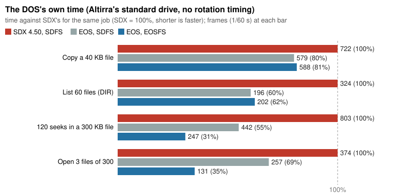
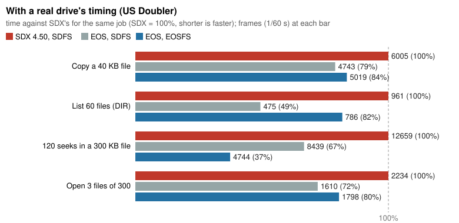
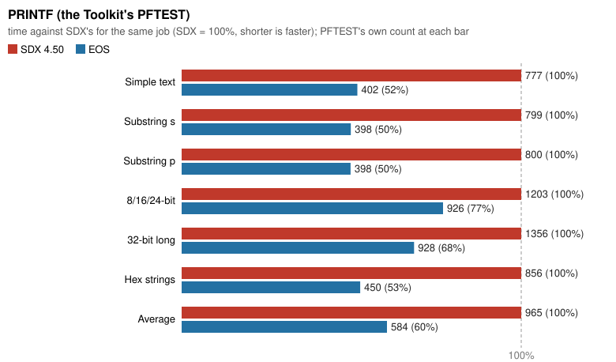
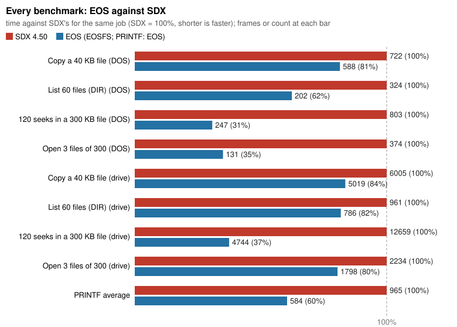
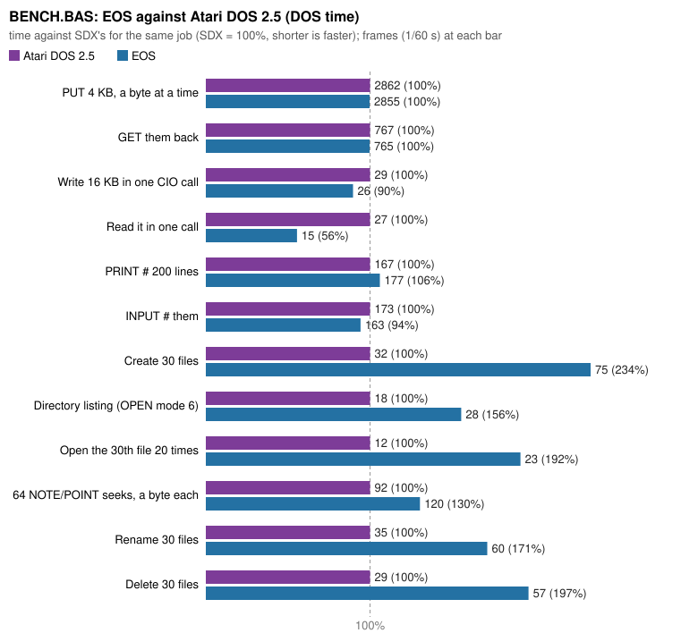
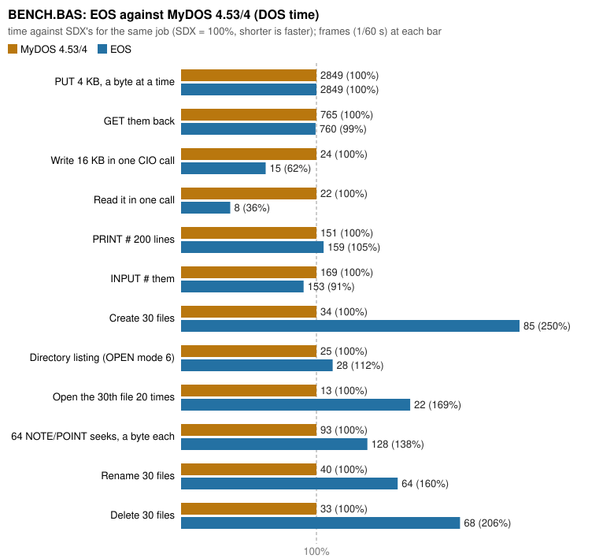
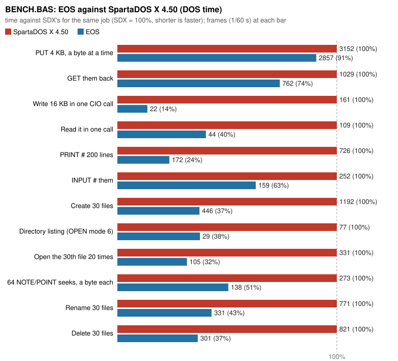

# EOS benchmarks: EOSFS against SDX's SDFS

EOS on its own file system (EOSFS, docs/EOSFS.md) against SpartaDOS X 4.50 on
SDFS, with EOS on SDFS for reference. Each system runs the same jobs on the same
disk (720 KB, 2880 sectors of 256 bytes) in the same emulated machine (Altirra,
NTSC, a US Doubler drive). Times are frames (1/60 s) between two readings of
the frame counter (tests/eos/TCK.COM); shorter is faster. The charts show each
time against SDX's for the same job. Made by `tools/bench.py` (the runs, to
build/bench.json) and `tools/benchmd.py` (this page).

The jobs:

- **Copy**: COPY of a 40 KB file to a new one (read and write).
- **DIR**: the listing of a directory of 60 files (to NUL:).
- **Seek**: 120 seeks to positions spread over a 300 KB file, one byte read at
  each (tests/eos/SKT.COM, with its loading): positioning inside a big file.
- **Open**: TYPE of the last 3 files of a directory of 300 files: finding a
  name in a big directory.
- **PRINTF**: the Toolkit's PFTEST, the library's PRINTF to the screen
  (its own timing; section PRINTF).

## The DOS's own time

Altirra's standard drive, with no rotation timing: it takes the XF551's
high speed commands, so both systems use them (SDX's SIO.SYS and EOS
try them when a drive does not answer the Ultra Speed question) and the
drive answers at once and takes or sends bytes as fast as the computer
handles them. What is measured is the DOS itself (its code, its cache
and its look-ups) and how fast its SIO driver moves the bytes.

| job | SDX 4.50, SDFS | EOS, SDFS | EOS, EOSFS | EOS, EOSFS vs SDX |
|---|---|---|---|---|
| Copy a 40 KB file | 722 | 579 | 588 | 1.2x |
| List 60 files (DIR) | 324 | 196 | 202 | 1.6x |
| 120 seeks in a 300 KB file | 803 | 442 | 247 | 3.3x |
| Open 3 files of 300 | 374 | 257 | 131 | 2.9x |

## With a real drive's timing

Without the SIO patch and with accurate disk timing, the drive's rotation
and the serial transfers count, as on a real machine. Both systems ask the
US Doubler for its Ultra Speed rate (`?`) and use it.

| job | SDX 4.50, SDFS | EOS, SDFS | EOS, EOSFS | EOS, EOSFS vs SDX |
|---|---|---|---|---|
| Copy a 40 KB file | 6005 | 4743 | 5019 | 1.2x |
| List 60 files (DIR) | 961 | 475 | 786 | 1.2x |
| 120 seeks in a 300 KB file | 12659 | 8439 | 4744 | 2.7x |
| Open 3 files of 300 | 2234 | 1610 | 1798 | 1.2x |

## With extended memory: the second-level cache

On a machine with more than 128K, EOS keeps a second-level sector cache
in one 16 KB bank (docs/EOSFS.md 6): sectors its cache drops are kept
there, a later miss is a memory copy instead of a disk read. The same
jobs, EOS on EOSFS, on 64K and on 320K (RAMBO):

| job | 64K, Altirra's drive | 320K | 64K, real drive timing | 320K |
|---|---|---|---|---|
| Copy a 40 KB file | 588 | 599 | 5019 | 4659 |
| List 60 files (DIR) | 202 | 200 | 786 | 348 |
| 120 seeks in a 300 KB file | 247 | 311 | 4744 | 4855 |
| Open 3 files of 300 | 131 | 122 | 1798 | 488 |

Directories and big directories gain most; a copy streams past it (sectors
read or written to their end are not kept); random seeks cost a little: the
partly read data sectors are copied into the bank and seldom read again.

## PRINTF

PFTEST, the PRINTF benchmark on the SDX Toolkit disk, prints lines through
the library's PRINTF in six ways (plain and inverse text, %s and %p
substrings, 8/16/24-bit and 32-bit numbers, hex) and times each test with
the frame counter. The numbers are the ones it prints (its own count,
shorter is faster; the percentages it prints after them compare with
its own reference and are left out). The screen output is part of
each time.

| test | SDX 4.50 | EOS | EOS vs SDX |
|---|---|---|---|
| Simple text | 777 | 402 | 1.93x |
| Substring s | 799 | 398 | 2.01x |
| Substring p | 800 | 398 | 2.01x |
| 8/16/24-bit | 1203 | 926 | 1.30x |
| 32-bit long | 1356 | 928 | 1.46x |
| Hex strings | 856 | 450 | 1.90x |
| Average | 965.167 | 583.667 | 1.65x |

## Every benchmark

EOS (on EOSFS) against SDX in every job, with both timings, and PRINTF.

All the runs, in frames (1/60 s; seconds in brackets):

| job | timing | SDX 4.50, SDFS | EOS, SDFS | EOS, EOSFS |
|---|---|---|---|---|
| Copy a 40 KB file | DOS only | 722 (12.0 s) | 579 (9.7 s) | 588 (9.8 s) |
| List 60 files (DIR) | DOS only | 324 (5.4 s) | 196 (3.3 s) | 202 (3.4 s) |
| 120 seeks in a 300 KB file | DOS only | 803 (13.4 s) | 442 (7.4 s) | 247 (4.1 s) |
| Open 3 files of 300 | DOS only | 374 (6.2 s) | 257 (4.3 s) | 131 (2.2 s) |
| Copy a 40 KB file | drive | 6005 (100.1 s) | 4743 (79.0 s) | 5019 (83.7 s) |
| List 60 files (DIR) | drive | 961 (16.0 s) | 475 (7.9 s) | 786 (13.1 s) |
| 120 seeks in a 300 KB file | drive | 12659 (211.0 s) | 8439 (140.7 s) | 4744 (79.1 s) |
| Open 3 files of 300 | drive | 2234 (37.2 s) | 1610 (26.8 s) | 1798 (30.0 s) |

The runs' raw results are in build/bench.json (tools/bench.py).

## Why

- EOS does less work per sector: a larger cache (9 buffers), writes kept
  until a file is closed or the cache needs the buffer, and a directory
  read without per-entry overhead.
- EOSFS keeps a file as extents (runs of sectors), so positioning is
  arithmetic on the extent list instead of a walk through SDFS's sector maps.
- EOSFS directories have a name index: opening a file reads the index, then
  only the entries whose name hash matches, not the whole directory.
- With a real drive, the disk's rotation and the serial transfers take most
  of the time, so the differences are smaller.
- EOS keeps a disk's cached sectors from one command to the next while the
  disk stays the same (its sequence number and random id), and when the cache
  needs a changed buffer, it writes it together with the changed sectors
  right after it, in one pass of the disk.
- A file's data sector, once read or written to its end, is the first to
  leave the cache. A copy streams through one or two buffers while the
  bitmap, the extent lists and the directories stay, so the head does not
  go back and forth across the disk for them.
- A whole new sector goes to the disk straight from the program's buffer,
  and with Ultra Speed the cache's sectors go to and from the drive without
  a copy through main memory: EOS is ready for the next sector before the
  disk has turned past it, also at a track change.
- Both systems ask the drive for its Ultra Speed rate on first use; EOS
  then does its transfers with its own polled SIO at that rate.
- PRINTF keeps what it prints and writes it 16 characters at a time: one
  call through the kernel and CIO for each 16 characters instead of one for
  each character. DIR and other commands print through it as well.

## From BASIC, against Atari DOS 2.5, MyDOS and SpartaDOS X

The same Atari BASIC program, tests/bench/BENCH.BAS, on each DOS, with EOS
beside it on the same kind of disk: an Atari DOS 2 disk (720 x 128) against
DOS 2.5, a MyDOS disk (720 x 256) against MyDOS 4.53/4, an SDFS disk
(720 x 256) against SpartaDOS X (whose ATARIDOS.SYS only reads DOS 2 disks).
BENCH.BAS and its files are in D2:; each DOS boots as it does (DOS 2.5 and
MyDOS from their own disks in D1:, EOS and SDX from their cartridges) and
runs BASIC (the emulator's Altirra BASIC 1.59, the same for all). Times are
frames from the frame counter, around each job; shorter is faster; a
negative number is the error the job stopped with. Made by
`tools/basbench.py`.

Two timings: **DOS** has Altirra's SIO patch, with EOS and SDX set to the
OS's SIO (SIOSET 2 NORMAL), so every DOS's transfers take no time and the
DOS's own work is what is measured; **drive** is a US Doubler with accurate
timing, each DOS as it is: EOS and SDX use its Ultra Speed, DOS 2.5 and MyDOS
the standard speed (they have no high speed SIO), as a user would have it.

### Atari DOS 2.5, DOS timing

| job | Atari DOS 2.5 | EOS | EOS vs Atari DOS 2.5 |
|---|---|---|---|
| PUT 4 KB, a byte at a time | 2862 | 2855 | 1.0x |
| GET them back | 767 | 765 | 1.0x |
| Write 16 KB in one CIO call | 29 | 26 | 1.1x |
| Read it in one call | 27 | 15 | 1.8x |
| PRINT # 200 lines | 167 | 177 | 0.9x |
| INPUT # them | 173 | 163 | 1.1x |
| Create 30 files | 32 | 75 | 0.4x |
| Directory listing (OPEN mode 6) | 18 | 28 | 0.6x |
| Open the 30th file 20 times | 12 | 23 | 0.5x |
| 64 NOTE/POINT seeks, a byte each | 92 | 120 | 0.8x |
| Rename 30 files | 35 | 60 | 0.6x |
| Delete 30 files | 29 | 57 | 0.5x |

EOS is faster on 5 of the 12 jobs.

### Atari DOS 2.5, drive timing

| job | Atari DOS 2.5 | EOS | EOS vs Atari DOS 2.5 |
|---|---|---|---|
| PUT 4 KB, a byte at a time | 3874 | 3457 | 1.1x |
| GET them back | 1098 | 1055 | 1.0x |
| Write 16 KB in one CIO call | 2758 | 1034 | 2.7x |
| Read it in one call | 970 | 902 | 1.1x |
| PRINT # 200 lines | 2223 | 735 | 3.0x |
| INPUT # them | 1257 | 480 | 2.6x |
| Create 30 files | 6194 | 1454 | 4.3x |
| Directory listing (OPEN mode 6) | 104 | 27 | 3.9x |
| Open the 30th file 20 times | 1485 | 23 | 64.6x |
| 64 NOTE/POINT seeks, a byte each | 1198 | 1156 | 1.0x |
| Rename 30 files | 1375 | 391 | 3.5x |
| Delete 30 files | 4890 | 1322 | 3.7x |

EOS is faster on 12 of the 12 jobs.

### MyDOS 4.53/4, DOS timing

| job | MyDOS 4.53/4 | EOS | EOS vs MyDOS 4.53/4 |
|---|---|---|---|
| PUT 4 KB, a byte at a time | 2849 | 2849 | 1.0x |
| GET them back | 765 | 760 | 1.0x |
| Write 16 KB in one CIO call | 24 | 15 | 1.6x |
| Read it in one call | 22 | 8 | 2.8x |
| PRINT # 200 lines | 151 | 159 | 0.9x |
| INPUT # them | 169 | 153 | 1.1x |
| Create 30 files | 34 | 85 | 0.4x |
| Directory listing (OPEN mode 6) | 25 | 28 | 0.9x |
| Open the 30th file 20 times | 13 | 22 | 0.6x |
| 64 NOTE/POINT seeks, a byte each | 93 | 128 | 0.7x |
| Rename 30 files | 40 | 64 | 0.6x |
| Delete 30 files | 33 | 68 | 0.5x |

EOS is faster on 4 of the 12 jobs.

### MyDOS 4.53/4, drive timing

| job | MyDOS 4.53/4 | EOS | EOS vs MyDOS 4.53/4 |
|---|---|---|---|
| PUT 4 KB, a byte at a time | 3390 | 3285 | 1.0x |
| GET them back | 1111 | 1007 | 1.1x |
| Write 16 KB in one CIO call | 971 | 821 | 1.2x |
| Read it in one call | 858 | 658 | 1.3x |
| PRINT # 200 lines | 988 | 627 | 1.6x |
| INPUT # them | 850 | 376 | 2.3x |
| Create 30 files | 7404 | 2017 | 3.7x |
| Directory listing (OPEN mode 6) | 195 | 27 | 7.2x |
| Open the 30th file 20 times | 2759 | 23 | 120.0x |
| 64 NOTE/POINT seeks, a byte each | 1469 | 1314 | 1.1x |
| Rename 30 files | 4460 | 432 | 10.3x |
| Delete 30 files | 7402 | 2021 | 3.7x |

EOS is faster on 12 of the 12 jobs.

### SpartaDOS X 4.50, DOS timing

| job | SpartaDOS X 4.50 | EOS | EOS vs SpartaDOS X 4.50 |
|---|---|---|---|
| PUT 4 KB, a byte at a time | 3152 | 2857 | 1.1x |
| GET them back | 1029 | 762 | 1.4x |
| Write 16 KB in one CIO call | 161 | 22 | 7.3x |
| Read it in one call | 109 | 44 | 2.5x |
| PRINT # 200 lines | 726 | 172 | 4.2x |
| INPUT # them | 252 | 159 | 1.6x |
| Create 30 files | 1192 | 446 | 2.7x |
| Directory listing (OPEN mode 6) | 77 | 29 | 2.7x |
| Open the 30th file 20 times | 331 | 105 | 3.2x |
| 64 NOTE/POINT seeks, a byte each | 273 | 138 | 2.0x |
| Rename 30 files | 771 | 331 | 2.3x |
| Delete 30 files | 821 | 301 | 2.7x |

EOS is faster on 12 of the 12 jobs.

### SpartaDOS X 4.50, drive timing

| job | SpartaDOS X 4.50 | EOS | EOS vs SpartaDOS X 4.50 |
|---|---|---|---|
| PUT 4 KB, a byte at a time | 3508 | 3101 | 1.1x |
| GET them back | 1182 | 965 | 1.2x |
| Write 16 KB in one CIO call | 879 | 731 | 1.2x |
| Read it in one call | 681 | 670 | 1.0x |
| PRINT # 200 lines | 1335 | 439 | 3.0x |
| INPUT # them | 540 | 368 | 1.5x |
| Create 30 files | 9408 | 4973 | 1.9x |
| Directory listing (OPEN mode 6) | 171 | 71 | 2.4x |
| Open the 30th file 20 times | 1750 | 738 | 2.4x |
| 64 NOTE/POINT seeks, a byte each | 1303 | 1162 | 1.1x |
| Rename 30 files | 3827 | 2030 | 1.9x |
| Delete 30 files | 6091 | 3310 | 1.8x |

EOS is faster on 12 of the 12 jobs.
