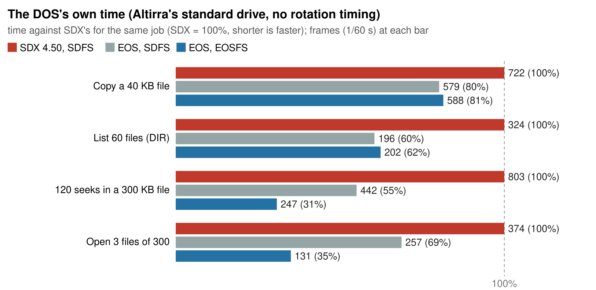
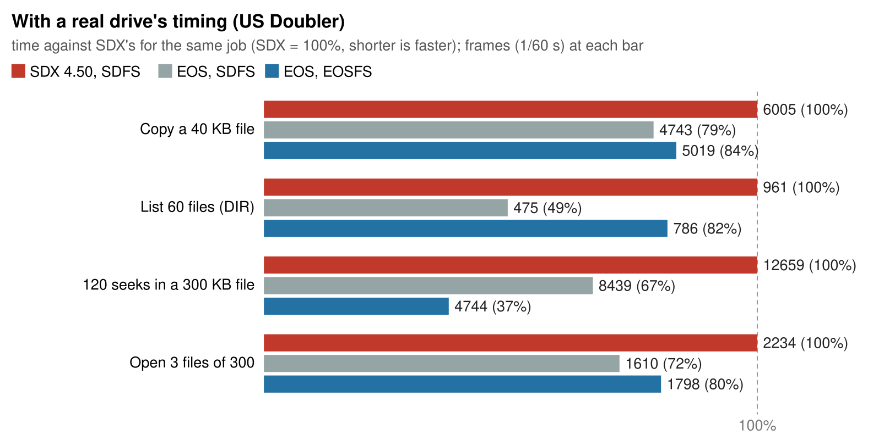
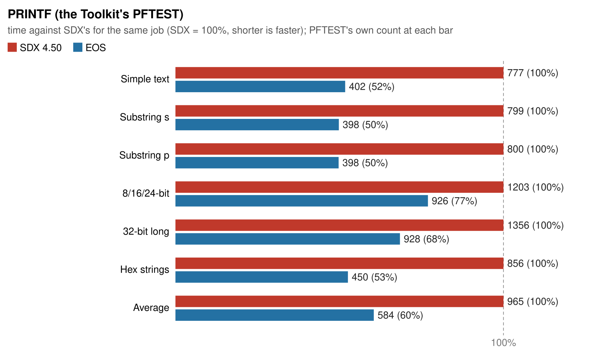
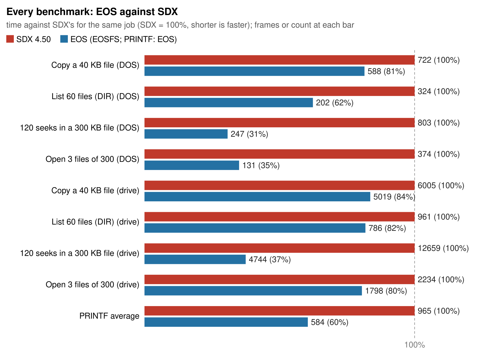
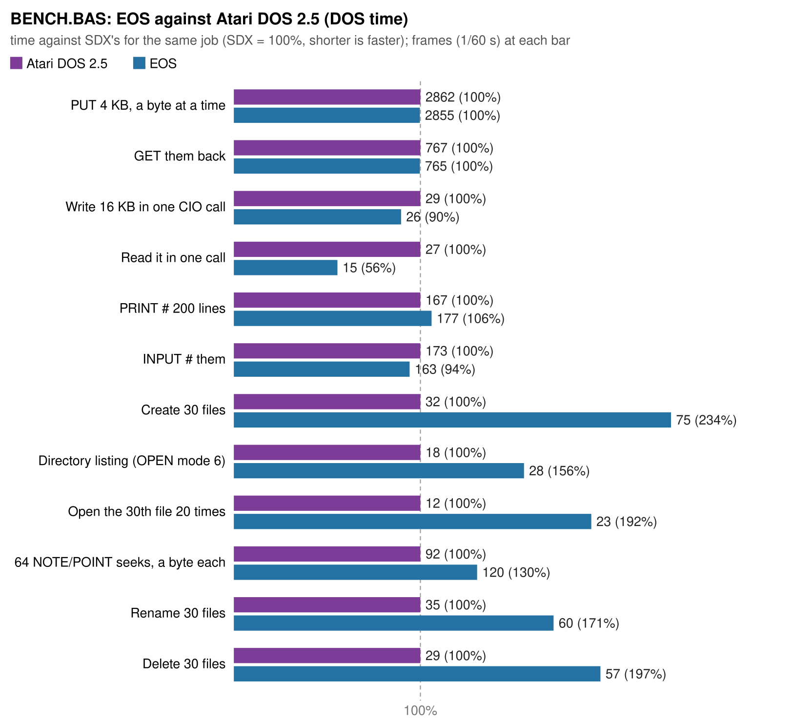
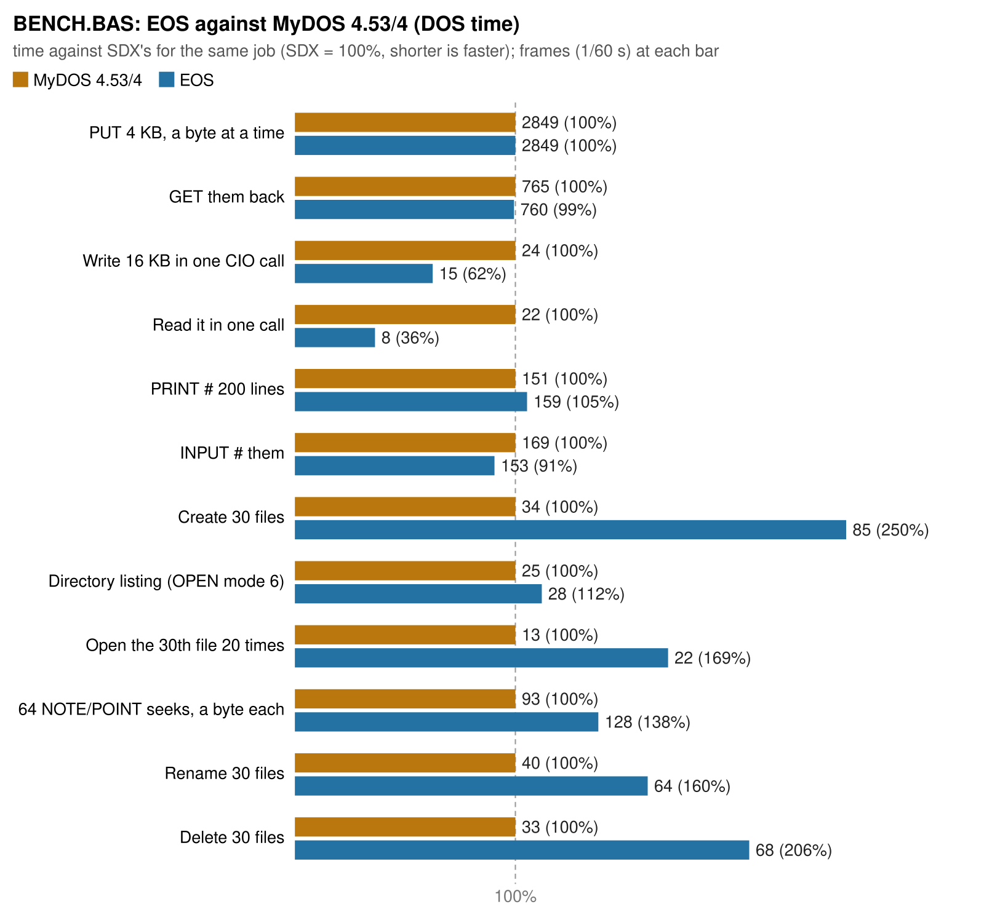
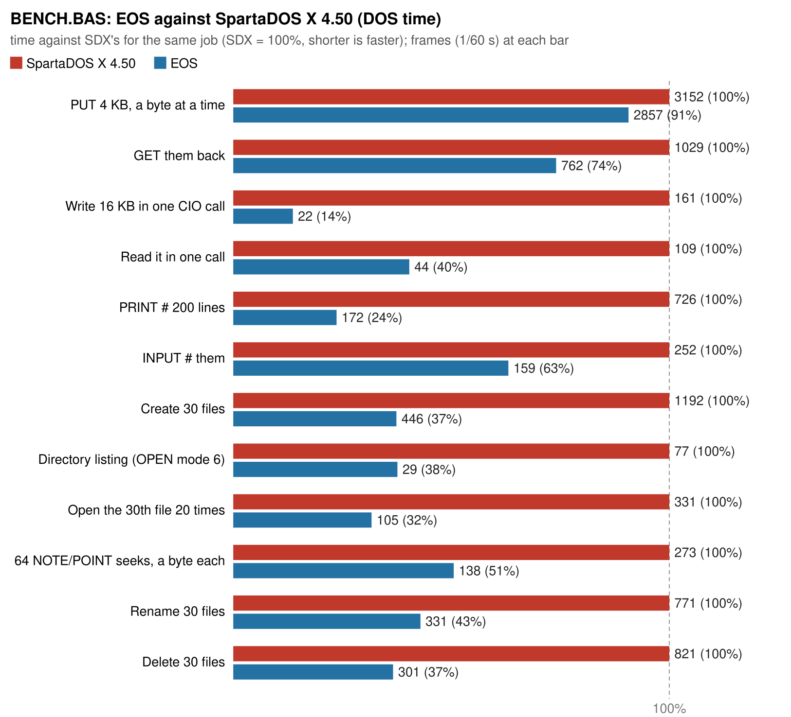

<!-- Generated by tools/mkhandbook.py from the documents in docs/:
     edit those, then run make handbook. -->

# Why EOS? {#why-eos}

There are many amazing DOSes for the atari 8bit. SDX, BW-DOS, MyDOS, and of course, Atari DOS.  So why did I build this one?

For years I have wanted specific things from my Ataris.  Speed, realiability, you know the standards. And we have that. But I also wanted flexibility.  I wanted to be able to optimize the code, make it faster, more efficient. I wanted to be able to write drivers without trying to figure out the undocumented stuff. Or figure out what someone intended with what they wronte in a manual - or in a magazine interview 40 years ago.

This is why Extended Operating System (EOS) was created.  It is a new DOS for the Atari 8-bit that is designed to be fast, reliable, and flexible.  It is designed to be easy to use and easy to understand.  It is designed to be extensible, so that new features can be added without breaking existing code.

# User Manual {#user-manual}

EOS (Extendable Operating System) is a small Linux-like environment for Atari
8-bit computers. It retains enough of the documented SDX program ABI to run
many existing relocatable programs, but its shell and native filesystem have
EOS semantics. Its resident disk filesystem is EOSFS v2;
foreign disk formats are handled by transient Toolkit utilities so their
parsers and state do not consume kernel memory.

This manual covers getting started, configuring and operating EOS, using the
full command set, and programming for EOS. Build and code maintenance
instructions are in Building EOS (docs/BUILDING_EOS.md). The command pages
are also available on the machine with `MAN command`.

## 1. What you need

### To run EOS

- An Atari 8-bit XL/XE computer, or a compatible emulator.
- One of the EOS images in a cartridge or flash slot: `EOS.car` in an
  AtariMax/Maxflash 8 Mbit (1 MiB) cartridge, `EOS_U1MB.rom` in an Ultimate
  1MB's SDX slot, or `EOS_SIC.car`/`EOS_SICP.car` in a SIC!/SIC!+ cartridge
  (see [Hardware compatibility status](#hardware-compatibility-status)).
- A disk device or image for files and configuration. EOS can start without a
  DOS disk because its command processor and core drivers are in the cartridge.

The standard image uses the AtariMax 1 MiB format of the SDX 4.5 cartridge. Hardware
and installed memory affect which optional drivers and memory modes are useful.

## 2. First boot

1. Attach or mount the EOS cartridge and power on or reset the Atari.
2. EOS initializes its drivers and command processor. The default command
   search path and manual path are `CAR:`; built-in commands work even if no
   disk is mounted.
3. Insert or mount an EOSFS data disk, then inspect it with `ls D1:/` or
   `CHKDSK D1:`. Use `fsinfo D1:` for foreign media.
4. For a quick orientation, try:

   ```text
   ver
   dev
   mem
   ls D1:/
   man cp
   ```

At a prompt, a drive letter is a drive number: `A:` is D1, `B:` is D2, and so
on through `O:` for D15, except for a letter that names a CIO device. When a
handler for the letter is installed (the OS has C: E: K: P: S:, others come
with drivers: R:, H:, N: ...), the letter is that device, never a drive:

- `D:` is always D1:, as in programs that open `D:` through CIO (`DIR D:`,
  `TYPE D:FILE.TXT`), whatever the current drive.
- `E:` is the screen (CON:), `P:` the printer (PRN:).
- Other CIO letters (`C:`, `K:`, `S:`, `R:` ...) answer 130 (Nonexistent
  device): EOS's commands reach only its own devices.

A drive whose letter is a CIO device's is written `D` and its number, or its
letter from drive 10 on: `D3:`, `D4:`, `D5:`, `DK:` (drive 11). EOS shows
those drives so wherever it names a drive (DF, PWD, FIND, MAP, the prompt's
`$L`, the RAM disk's `$RAMDISK`). `D1:` ... `D9:` and `DA:` ... `DO:` always
name drives. A device name such as `CAR:` selects the cartridge file
system. (SDX reads `A:` ... `O:` as drives whatever CIO has: its `D:` is
D4:, its `E:` drive 5.)

## 3. Command line and paths

EOS accepts a compact POSIX-like command line. Commands are either built into the
command processor, supplied by the cartridge, or loaded as program files from
the search path/current directory. Enter a command name followed by its
parameters; for example:

```text
ls D1:/games/
cp D1:/notes.txt D2:/notes.txt
```

The command line keeps the four most recent commands. Up and Down move through
that history; Left and Right move the cursor, and TAB completes filenames.
Each history entry retains its first 63 bytes, keeping the default reservation
to 257 bytes.

Built-in command words and their traditional slash options are case-neutral.
External command files, like every other native file, are looked up with exact
case; the default cartridge files and examples use lowercase. In command
syntax, square
brackets mean optional text, `|` separates alternatives, and a word in
lowercase such as `file` or `unit` stands for a value you supply. The options
available depend on the command; a slash option is not universal. Most
commands accept several option letters together only where their own help
page says so.

The command processor supports quoted arguments, file redirection and
pipelines. Single quotes preserve literal bytes; double quotes preserve blanks
and allow the shell's variable/escape processing; backslash quotes the next
byte. `<file` supplies standard input, `>file` creates/truncates standard
output, and `>>file` appends. `<<file` remains an input alias. The first input
and output redirection is used. Operators inside quotes or after backslash are
ordinary bytes. `A | B` connects A's output to B's input through temporary
files. `$?` is the previous status. `A && B` runs B after success and `A || B`
runs B after failure; a pipeline's status is its last stage. For example:

```text
cat D1:/docs/*.txt | less
man copy | less
ls >D1:/files.txt
echo another-line >>D1:/files.txt
```

Redirections are processed by the command processor before it invokes a
program. A program that uses the DOS standard stream APIs can therefore work
with the keyboard, screen, files, devices, and pipes. Some programs open the
screen or keyboard directly and may not honor redirection.

Native paths use `/` between directories. A leading `/` starts at the volume
root; `.` is the current directory and `..` is the parent. If a drive or
directory is omitted, EOS uses the current drive or current directory.

```text
cd                 ; show current directory
cd D1:/games/       ; change directory on D1
pwd                ; print current directory
ls *.com            ; list matching files
```

EOSFS names are 1 to 31 printable ASCII bytes, may contain spaces, and are not
restricted to 8.3.
Complete paths are limited to 127 bytes. Wildcards include `*` and `?`. File
and directory names are case-sensitive, and the keyboard starts in lowercase
mode. The files shipped on `CAR:` use lowercase names. Built-in command words
are not filenames and remain case-neutral. A semicolon separates entries in
`$PATH` and `$MANPATH`.
Commands can be redirected or piped where supported by the command processor;
for example, `MAN DIR | LESS` views a manual page a screen at a time.

## 4. Startup files and configuration

At startup EOS checks drive D1: for `eossys.sys`. If it is absent, EOS tries
`config.sys`. The syntax is the same for both names. EOS then runs
`eosauto.bat` when present, falling back to `autoexec.bat`. It does not run
`autorun.sys`. Hold OPTION during startup
to bypass the configuration file.

EOS includes the EOSFS disk and SIO drivers, so a basic setup does not need
`DEVICE` lines. Configuration commands include:

```text
; Example eossys.sys
SET PATH=CAR:;D1:/utils
SET MANPATH=CAR:;D1:/man
SET PROMPT=D$N$P/
DEVICE RAMDISK 1
```

Lines beginning with `;` are comments. A `?` prefix is accepted before a
configuration line; EOS executes that line without an interactive question.
Supported configuration directives
include:

- `SET name=value` to define an environment variable.
- `DEVICE driver [parameters]` to install a driver from the available files.
- `USE NONE`, `USE OSRAM`, or `USE BANKED` to select memory use.
- `ECHO text` to display startup text.
- `MERGE file` to switch configuration input to another file (default
  extension `.CFG`). The rest of the current file is not read afterward.

EOS initializes `$PATH=CAR:`, `$PROMPT=D$N$P/`, `$SYSERR=CAR:SYSERR.MSG`,
`$MAXDRV=O:`, and `$MANPATH=CAR:` by default. Use `SET` to inspect variables;
`SET NAME=value` changes one, and `SET NAME` removes it. `PATH` is a helper
for changing the command search path. Keep `CAR:` in the path so built-in
cartridge commands remain easy to find.

### Environment variables used by EOS

The command pages mention variables at the point where they apply. This
summary covers variables consumed by EOS's command processor and supplied
commands; applications and third-party drivers may define more.

| Variable | Purpose |
| --- | --- |
| `PATH` | Program search order. The current directory is also searched. |
| `PROMPT` | Prompt template; `PROMPT` expands `$L`, `$N`, `$P`, `$D`, `$T`, and `$R`. |
| `MANPATH` | Directories and devices searched by `MAN`. Default: `CAR:`. |
| `PAGER` | Program used by `MAN` to page a help file. |
| `SYSERR` | File containing messages for system error codes. Default: `CAR:SYSERR.MSG`. |
| `MAXDRV` | Highest drive shown by commands that enumerate drives. Default: `O:`. |
| `DAYTIME` | Date order: `1` means month first; otherwise day first. |
| `TEMP` | Directory for temporary files used by commands such as `MAN` and pipelines. |
| `BASIC` | File used to save and restore built-in BASIC memory. A RAM disk supplies a default if unset. |
| `CAR` | File used to save and restore the plugged-in cartridge's memory. A RAM disk supplies a default if unset. |
| `RAMDISK` | Default drive/path for Toolkit RAM-disk restore tools. Set by RAMDISK installation if unset. |
| `COMSPEC` | Command shell run in place of the prompt; used by shell integrations such as SpartaCommander. |
| `BATCH` | Batch file to run before the next prompt; EOS clears the variable as it consumes it. |
| `COPY` | Alternate program for the `COPY` command. |
| `ED` | Number of visible text-editor lines (1–22; default 10). |
| `SCRDEF` | Screen defaults reapplied by `CLS /F`. |
| `_01`–`_91` | Batch name and parameters 1–9, available while the batch file runs. |

Environment variables are substituted in command and batch lines as `$NAME`;
write `$NAME$` when the variable name must end before the following text.
Escape a dollar sign with `\$` in a batch line. See `MAN SET`, `MAN PROMPT`,
and `MAN BASIC` for command-specific details.

The startup batch file is a good place for commands such as `SETPATHS`,
`KEY ON`, or application setup. Read `MAN SET`, `MAN PATH`, and
`MAN SETPATHS` for details.

Configuration errors and unrecognized lines do not stop later configuration
lines from running. EOS's built-in configuration file in `CAR:` shows the
default setup and documents the supported directive syntax.

Batch files are text files with one command per line. A line beginning with
`;` (leading spaces are allowed) is a comment. `ECHO ON` displays lines as
they run; echo is off by default. Calling `-NAME` runs `NAME.BAT`; parameter
variables are named `_01` for the batch name and `_11` through `_91` for
parameters 1 through 9, so a line can refer to the first argument as `$_11`.
Within a batch line, `%0` through `%9` expand to the same batch name and
parameters. `$NAME` substitutes an environment variable and `$NAME$` ends the
variable name where it touches other text; `\$` leaves a literal dollar sign.
Errors from a command processor built-in that indicate bad parameters or a
missing device stop the batch; `ERROR ON` makes any command error stop it.
`$BATCH` can name a batch file to run before the next prompt; EOS deletes the
variable as it consumes it.

## 5. Files and directories

Common file tasks:

```text
DIR D1:                 ; list drive contents
DIR /W                  ; names in columns
TYPE README.TXT /P      ; display text, pause each screen
COPY *.TXT D2:          ; copy matching files
cp -r D1:/SRC D2:/SRC   ; recursively copy a directory tree
RENAME OLD.TXT NEW.TXT
DEL *.BAK
mkdir D1:/DOCS
cd D1:/DOCS
```

`DIR` displays names, sizes, dates, and times. `DIRS` gives a compact Atari
DOS-style listing. Attribute filters can include archived, hidden, protected,
and directory entries; `DIR +` includes all attributes. `TYPE` writes a text
file to the screen, while `LESS` and `MORE` provide paged viewing. `COPY`
supports overwrite prompts, quiet mode, move mode, recursive copies, and
verification; see `MAN COPY` for its switches.

`DEL`/`ERASE` removes files; `DELTREE` removes a directory tree. `UNERASE` may
restore deleted entries while their directory slots and data have not been
reused. `RENAME` changes file names, `CHDIR`/`CD` changes a current directory,
and `RMDIR` removes an empty directory. Check exact syntax with `MAN`.

To run a program, enter its name. EOS searches `$PATH` and then the current
directory. For a program in a specific location, give its path. `LOAD`
loads without running; `X` provides additional load/run modes. Programs can
be run directly from EOSFS or copied/imported from a foreign filesystem with
a transient Toolkit utility.

## 6. Disks and filesystems

EOS mounts only EOSFS v2 volumes in the resident DSK: driver. SDFS, DOS 2 and
MyDOS access belongs in transient Toolkit import/export/check tools. This
keeps legacy directory parsers, 8.3 buffers and filesystem-specific state out
of resident memory.

EOS looks at a disk again (for another disk in the drive) when a drive is
used after more than a second without use; within a second of the last
access the disk cannot have been changed, and EOS keeps what it has read.
A program that writes a disk's sectors itself through SIO, past EOS, should
close its files on that drive first, as with any DOS that caches.

Use these commands before changing media:

```text
CHKDSK D1:     ; filesystem, sector size, free and total space
DF D1:         ; free-space summary
MAP            ; device/drive map
```

### Formatting

`FORMAT` destroys data on the selected disk and creates EOSFS only. Before formatting, confirm the
drive and copy any files you need elsewhere. Run `FORMAT` without parameters
for the interactive menu. It can choose unit, volume name, density, geometry,
SIO speed, and geometry. Resident FORMAT creates EOSFS v2.

Examples:

```text
FORMAT                 ; interactive menu
FORMAT /Q D2: WORK     ; quick EOSFS initialization after confirmation
FORMAT /QQ D2: WORK    ; quick EOSFS initialization without confirmation
```

Quick format rebuilds an empty EOSFS filesystem; it is not a secure erase.
`FORMAT` also has a
directory-only operation for suitable RAM disks and hard disks. Read
`MAN FORMAT` before formatting unfamiliar media. A disk using 512-byte sectors
cannot be booted by the stock Atari OS.

### EOSFS

EOSFS v2 is the native format. It uses 44-byte directory records, 31-byte
case-sensitive names and extent lists that keep contiguous data runs together.
Revision `$47` is clean and `$48` marks an interrupted write. See
[EOSFS design](#eosfs-format) for the on-disk specification.

### Bootable disks

FORMAT writes the EOSFS loader. `BOOT file` records the file's first extent
list in sector 1; it does not copy the file or
replace the loader. Erasing or replacing the file clears the boot mark.

EOSFS images with 128 or 256 byte sectors are bootable. The stock OS
cannot boot 512 byte sectors. See Building EOS for the host image command.

## 7. Devices, drivers, and memory

`DEV` lists installed kernel devices; `MEM` reports memory use and selected
memory mode. Core EOSFS DSK: and SIO support is built into EOS. Additional
drivers and utilities are supplied in the cartridge or can be loaded from
disk with `DEVICE` in `EOSSYS.SYS` / `CONFIG.SYS`.

### Driver installation and parameters

`DEVICE name [parameters]` loads a `name.SYS` file from the normal program
search locations, or activates an EOS built-in driver. The following list
covers the EOS-supplied drivers and their parameters. Drivers not listed here
may have their own documentation. The EOSFS disk path and SIO dispatch are
resident kernel services. `DEVICE SIO /A` or `/C` can still select the OS SIO
path; no foreign filesystem driver is resident.

| Driver | Syntax | Behavior and options |
| --- | --- | --- |
| `RAMDISK` | `RAMDISK [drive[,nbanks]] [/S]` | Installs one RAM disk, defaulting to O: and all available extended-memory banks except four reserved for programs. `nbanks` selects the number of banks. The disk has 256-byte sectors and is initialized as EOSFS v2 unless a same-size EOSFS disk is already present. A RAM disk requires extended memory. EOS accepts `/S`; it has no additional effect in the current implementation. It sets default `RAMDISK`, `BASIC`, `CAR`, and `TEMP` variables if they were unset. |
| `ENV` | `DEVICE ENV` | Moves the environment into an extended-memory bank, providing up to 16 KiB instead of the small default area. Without extended memory, the environment stays in its original location. |
| `DOSKEY` | `DOSKEY [aliases-file] [/X]` | Command-line editing and a four-line history are enabled by default. Up/Down, Ctrl-P/Ctrl-N, or F1/F2 select history; Left/Right edit at the cursor; TAB completes filenames; Shift-Clear clears the screen; BREAK cancels the line. `DOSKEY` optionally loads `NAME=COMMAND` aliases and enables `&` command chaining; `/X` runs `DIR` on an empty command line. |
| `RUNEXT` | `RUNEXT [association-file]` | Loads file-extension associations; defaults to `CAR:RUNEXT.CFG`. `RUNEXT` at the prompt lists the active rules. A rule has `[!^]EXT[:EXT...],PROGRAM[,PARMS]`; `!` requires Shift, `^` requires Ctrl, and `%` in parameters is replaced by the selected filename (otherwise the filename is appended). Rules are checked in file order. Lines beginning with `;` or `*` are comments. Prefix a command with `+` to skip associations. |
| `COMEXE` | `DEVICE COMEXE` | Makes `NAME.EXE` (or `NAME` when `NAME.COM` is absent) run through `X`, with cartridges disabled. Prefix the command with `+` to bypass this behavior. |
| `RTIME8` | `DEVICE RTIME8` | Enables the hardware clock: the R-Time 8 cartridge if it answers, otherwise the Ultimate 1MB's clock (DS1305) when a U1MB is detected. With neither, EOS prints `R-Time 8 not present` and runs its software clock. `DATE` and `TIME` set the U1MB clock as well (24-hour mode). This is also EOS's default without a configuration file. |
| `JIFFY` | `DEVICE JIFFY` | Enables the software clock, which advances from the last set time using the Atari frame clock. |
| `Z` | `DEVICE Z [/I|/S]` | Installs the `Z:` clock device. `/I` ignores unsupported XIO status requests; `/S` allows setting the clock. XIO 33 reads time, 35 reads date, 36 sets time, and 37 sets date. Each uses three byte operations. Other date/time formatting XIOs require `TD.COM`. |
| `XEP80` | `DEVICE XEP80.SYS [/P] [/U] [/V] [/1]` | Installs an 80-column XEP80 screen handler. `/P` selects 50 Hz, `/U` enables supported 31.5 kHz Ultra speed, `/V` selects VHOLD timing, and `/1` selects joystick port 1 (default port 2). The handler is based on Altirra's XEP80 driver and retains its own notices. |
| `CON64` | `DEVICE CON64` | Installs the software 64-column display; it needs extended memory. Use `CON 64` to select it and `CON 40` to return. Load it before `RAMDISK`. |
| `CON` | `DEVICE CON` | Loads the optional 80-column console handler when `CON.SYS` is available. `CON 80` selects it; the `CON` command page lists the widths. |
| `QUICKED` | `DEVICE QUICKED` | Compatibility placeholder for SDX's screen accelerator; EOS leaves the console handlers unchanged. |

`SIOSET` configures transfer speed and protocol for individual drives; `MAP`
maps physical units and changes their SIO selection. Their complete switches
are in the command reference below. Clock features depend on the installed
hardware or a manually set time. FATFS/CPMFS and other D3 filesystem-driver
interfaces are outside EOS's supported configuration.

Memory modes:

- `USE NONE`: do not reserve OS RAM for EOS use.
- `USE OSRAM`: use suitable RAM beneath the operating system ROM.
- `USE BANKED`: use supported banked extended memory.
- With more than 128K (more than four extended banks), EOS also keeps one
  16 KB bank as a second disk cache: sectors its cache has to drop are kept
  there, and reading them again costs a memory copy instead of a disk read.
  MEM shows that bank as not free.

Choose modes only when the machine and installed expansions support them.
`MEM` shows the active mode and available memory. Driver names and parameters
are specific to each driver; use the relevant man page and the configuration
examples shipped in the cartridge files.

## 8. Help and command groups

Use `MAN` for the machine-readable reference:

```text
MAN             ; list available pages
MAN COPY        ; show COPY help
MAN COPY | LESS ; page through help
```

Other useful commands include:

- System: `VER`, `MEM`, `DEV`, `MAP`, `CHKDSK`, `DF`.
- Navigation: `CD`/`CHDIR`, `PWD`, `SETPATHS`.
- Files: `DIR`, `DIRS`, `TYPE`, `COPY`, `RENAME`, `DEL`, `DELTREE`,
  `MKDIR`, `RMDIR`, `UNERASE`.
- Disk operations: `FORMAT`, `BOOT`, `CHVOL`, `SIOSET`.
- Screen and inspection: `CLS`, `ECHO`, `LESS`, `MORE`, `FIND`, `DUMP`,
  `PEEK`, `POKE`, `MDUMP`.
- Date and time: `DATE`, `TIME`, `TD`, `CHTD`.

The EOS Toolkit is a separate collection of disk utilities distributed on
`EOSTK.atr`. It is a native EOSFS v2 image with lowercase program names and
manual pages under `/man`, so it mounts directly on current EOS. It includes core
filters plus `fsinfo`, `fsexport`, and `fscreate` for bounded foreign
filesystem interchange. Toolkit
commands are separate `.COM` programs. After mounting the Toolkit disk as D1,
for example, add its root to `$PATH` and its manual directory to `$MANPATH`:

```text
path CAR:;D1:
set MANPATH=CAR:;D1:/man
ls
man ls
```

## 9. Compatibility notes

EOS is not a drop-in filesystem or shell replacement for SDX. It runs many
SDX relocatable programs through documented compatible entry points. Disk format
compatibility is provided by transient Toolkit programs, not resident mounts.
Compatibility does not mean every program's hardware
assumptions or every third-party driver works on every Atari configuration.

System filenames are `eossys.sys` and `eosauto.bat`; EOS falls back to
`config.sys` and `autoexec.bat`. This allows EOS-specific setup alongside
existing SDX files. See [EOS compatibility](#compatibility) for the
project's compatibility summary.

## 10. Troubleshooting

**EOS starts but a disk or command is missing**

- Check the connection, mounted image, and drive number with `MAP` and
  `CHKDSK D1:`.
- List the directory with `DIR D1:` and check the current directory with
  `PWD`.
- Check `PATH` using `PATH` or `SET PATH`; cartridge commands are found on
  `CAR:` by default.

**A command is not found**

- Check spelling and the current directory.
- Use a full drive/path or add the directory to `PATH`.
- Use `MAN command` to check whether it is built into the cartridge or part
  of the separate Toolkit.

**A program reports insufficient memory or fails to load**

- Run `MEM` to inspect the current memory mode and free memory.
- Remove held programs with `LOAD` (with no filename), where appropriate.
- Confirm that the program format and required hardware/memory are supported.

**A disk has errors or unexpected free space**

- Run `CHKDSK` and avoid writing further if data appears damaged.
- Back up readable files before using repair or formatting operations.
- Formatting erases the selected volume; verify the drive before confirming.

**Date or time is incorrect**

- Check `DATE /T` and `TIME /T`.
- Correct it with `DATE` and `TIME`; accurate startup time depends on a clock
  driver or setting it manually.

## 11. Programming for EOS

EOS is designed to run Atari binaries and SpartaDOS X programs. There are
three common ways to program for it:

1. Atari BASIC or exBASIC for interpreted or compiled BASIC applications.
2. Atari binary files for programs that need no DOS library.
3. SDX relocatable binaries for programs that use EOS/SDX library symbols.

### 11.1 Choose a target format

Use a plain Atari binary when the program is self-contained and can use the
Atari OS directly. The standard binary record begins with `$FFFF`, followed
by inclusive start and end addresses and that memory range's bytes. Additional
segments repeat start, end, and data. A run vector may specify where execution
starts. These files are commonly named `.COM` but the extension does not
determine the format.

Use an SDX relocatable binary when the program should run at an available
address, import EOS/SDX library routines, or use the DOS file and command
services. EOS implements the SDX relocatable loader and symbol interface.
MADS source commonly declares imports with `smb 'NAME'`, starts a relocatable
main block with `blk reloc main`, and writes address/symbol fixups with
`blk update address` and `blk update symbols`. See `tests/eos/*.asm` and
`toolkit/*.asm` for working EOS examples and the assembler syntax used by this
project.

EOS supports BW-DOS binaries as a compatibility target. While such a program
runs, EOS presents the BW-DOS COMTAB environment and dispatches supported
calls. This is primarily useful for existing BW-DOS software; new DOS-aware
programs should generally use SDX relocatable format.

### 11.2 A minimal relocatable assembly program

This example prints a message through the EOS/SDX `PUTC` library routine and
returns to the command processor. It follows the same style as
`tests/eos/HELLO.asm`:

```asm
PUTC     smb 'PUTC'

        blk reloc main
start   ldx #0
next    lda message,x
        beq done
        jsr PUTC
        inx
        bne next
done    rts
message dta c'Hello from EOS',$9B,0

        blk update address
        blk update symbols
```

Assemble the source in relocatable mode using your MADS setup, then place the
resulting binary on a disk or in a Toolkit directory. At the EOS prompt, run
it by name. The `smb` import requests the system symbol by name; the loader
resolves it when loading. `RTS` returns through the DOS loader. Use the
assembler's standard binary mode instead when producing an absolute Atari
binary.

### 11.3 Calling convention and system symbols

The EOS library keeps selected SDX-compatible calling conventions for the
symbols it exports. Library entry points are callable symbols resolved by the loader;
many receive parameters in A/X/Y or through shared work areas, and report
status through processor flags and/or shared variables. EOS's implementation
and tests are the source of truth for EOS behavior. Do not infer an undocumented
call convention from a routine's name.

The exported symbol names are in `eos/symbols.txt`. Important groups include:

- Command parsing and text: `U_ARGC`, `U_ARGV`, `U_GETPAR`, `U_GETNUM`,
  `U_GETADR`, `U_GEFINA`,
  `U_FAIL`, `PRINTF`, `FPRINTF`, `PUTC`, `GETS`, `PUTS`.
- File streams: `FOPEN`, `FCLOSE`, `FREAD`, `FWRITE`, `FGETC`, `FPUTC`,
  `FGETS`, `FPUTS`, `FSEEK`, `FTELL`, `FILELENG`, `REMOVE`, `RENAME`.
- Directories and metadata: `FFIRST`, `FNEXT`, `GETCWD`, `GETDFREE`,
  `MKDIR`, `RMDIR`, `RENDIR`, `CHDIR`, `CHMOD`, `CHVOL`.
- Environment and memory: `GETENV`, `PUTENV`, `NUMENV`, `MALLOC`, `XRWMEM`.
- Loader and symbols: `U_LOAD`, `U_UNLOAD`, `INSTALL`, `S_LOOKUP`, `S_ADD`,
  `S_NEXT`, `S_ADDIZ`.

`COMTAB` exposes the command processor's shared parameter buffer and work
area. Its layout is part of the EOS program interface; avoid hard-coded
offsets unless this manual or a known EOS example defines them.
`U_GETPAR` parses successive command parameters into the COMTAB parameter
area. It skips leading spaces, treats spaces and commas as separators,
preserves the returned parameter's case (while folding `/switches` to upper
case), and leaves the original command line unchanged. Commas can represent
an empty field (`A,,B`).

New native programs should use the shell sidecar when quoting or long
arguments matter. `U_ARGC` returns the word count in A, including the command
as argument zero. `U_ARGV` takes an index in A and returns C clear with AX
pointing to the selected bytes and Y holding their length; C set means the
index is absent. The returned scratch address remains valid until another
`U_ARGV` or filesystem path operation. There are at most 16 arguments and 127
bytes of parsed argument text. The public COMTAB line stays 64 bytes for old
programs.

This legacy `U_GETPAR` sample reads parameters until there are no more:

```asm
U_GETPAR smb 'U_GETPAR'
COMTAB   smb 'COMTAB'
PUTC     smb 'PUTC'

        blk reloc main
nextpar jsr U_GETPAR
        beq done
        ldx #$21              ; COMTAB parameter string in this example
nextch  lda COMTAB,x
        jsr PUTC
        inx
        cmp #$9B
        bne nextch
        lda #$9B
        jsr PUTC
        jmp nextpar
done    rts
        blk update address
        blk update symbols
```

The `$21` offset is shown to explain the existing sample, not as a substitute
for the COMTAB definition. See `tests/eos/HELLO.asm` and EOS Toolkit sources
for parameter parsing patterns.

### 11.4 Formatted output with PRINTF

`PRINTF` is commonly called with its format string and arguments stored
inline after the call. It consumes that data and returns to the instruction
after the last argument. The string ends with a zero byte. A few useful
format types are `%c` (one byte character), `%s` (string pointer), `%x`
(hexadecimal value), and `%b`, `%d`, `%e`, `%l` (unsigned 1-, 2-, 3-, and
4-byte decimal values). A width can precede the type; `%05d` pads a value to
five digits with zeroes. `%%` prints a percent sign. `FPRINTF` uses the same
format rules but writes to the currently open file.

```asm
PRINTF smb 'PRINTF'

        blk reloc main
start   jsr PRINTF
        dta c'File length: %d bytes',$9B,0
        dta a(length)
        rts
length  dta a(1234)
        blk update address
        blk update symbols
```

### 11.5 File I/O and redirection

For DOS-independent applications, use the Atari OS CIO interface that EOS
supports. EOS also provides the SDX-compatible file-stream library
(`FOPEN`, `FREAD`, `FWRITE`, `FCLOSE`,
and related symbols) for relocatable programs. This lets a program use the
same file calls on DSK:, CAR:, and supported devices without implementing
filesystem structures itself. Programs should check each open/read/write
result, close successful opens on every exit path, and use `FCLOSEAL` when
appropriate for cleanup.

The command processor can connect standard input and output to devices, files,
and pipes. A program intended for pipelines should use `GETC`/`GETS` for
standard input and `PUTC`/`PUTS` for standard output, rather than assuming the
screen or keyboard. The Toolkit examples `CAT`, `HEAD`, `TAIL`, `WC`, and `FT`
are useful EOS models for stream filters.

For programs using EOS's relocatable file-stream API, `FILE_P` points to an EOL- or
zero-terminated file specification. The standard parameter area includes
`file_id` at `$0760`, `mode` at `$0778`, `scan` at `$0779`, and `attr` at
`$077A`. The `tests/eos/FSW.asm` test demonstrates `FOPEN` modes 4 (read), 8
(create/write), 9 (append), and 12 (read/write update). It sets `scan` and
`attr` to zero for ordinary file opens.

`FREAD` and `FWRITE` use the shared transfer fields `addpos` (buffer address,
three bytes), `bytbuf` (requested byte count, two bytes), and `memreix`
(memory index). Memory index 0 is main RAM; extended-memory indexes are
platform-specific. On `FREAD`, X is 0 with N clear on success; at end of file
X is `$FF` and N is set. `FWRITE` returns X=0 on success; an error follows the
standard `U_FAIL` path. `FSEEK`, `FTELL`, and `FILELENG` use the three-byte
`addpos` field. These are EOS call contracts: `FREAD` and `FWRITE` return
X=0 with N clear after success, and `FREAD` returns X=`$FF` with N set at end
of file. Other file-service errors go through `U_FAIL`; the exported routine
contracts below define the remaining transfer and stream rules.

### 11.6 Running and debugging programs

- `FSTRUCT file` (Toolkit) inspects Atari segments, run/init addresses,
  relocatable blocks, fixups, and symbol records.
- `SL [prefix]` lists loaded/system symbols; `SL NAME address` adds a
  temporary symbol for debugging.
- `PEEK`, `POKE`, `MDUMP`, and `DPOKE` inspect or modify memory. Writes can
  crash EOS or corrupt files; use only with known addresses and values.
- `X file` runs with cartridges switched off for programs that need the RAM
  under the cartridge; library calls and normal redirection are unavailable
  in that mode.
- `MEM` shows available memory and memory mode. `LOAD` can keep a program
  resident; `INSTALL` keeps one resident until reset.
- `COMP`, `CRC32`, and `MD5` help verify program files and test results.

For BASIC applications, `BASIC` enters the built-in XL/XE BASIC. `BASIC file`
enables BASIC and loads/runs a binary with BASIC available. Compiled exBASIC
programs can use Atari BASIC conventions plus tested EOS CIO behavior; see
`tests/exbasic/` for examples covering file I/O, directories, XIO, RUN/COMMON,
and graphics.

### 11.7 Compatibility and portability

Use the EOS documented symbols and compatible interfaces when a program
should run on both EOS and SDX. Avoid relying on EOS-private symbols prefixed
with `_` or undocumented kernel internals. Avoid writing directly to SDFS or EOSFS
structures; use file and directory APIs. Do not assume every driver, banked
memory type, or hardware device is present. For source examples, use the
smallest interface needed and check return status before using returned data.

### 11.8 Exported symbol contracts

The following entries define every name in `eos/symbols.txt`. Callable entries
are subroutines unless marked as data. EOL means `$9B`; EOS file-service errors
usually enter `U_FAIL`. Hardware or filesystem drivers can provide additional
device-specific error codes.

#### Data and kernel exports

| Symbol | Contract |
| --- | --- |
| `COMTAB` | Base of command parameter/work memory. Shared with EOS; use only documented fields. |
| `FILE_P` | Pointer to current file specification, EOL- or zero-terminated. |
| `FLAG` | One-byte loader mode: bit 7 means load only; bit 6 means use only an explicit RUN vector (do not fall back to the first segment if none exists). `$C0` therefore runs INIT but does not run the program. Set before `U_LOAD`. `U_GETFLG` is a separate helper that uses this byte as its default/result. |
| `CURDEV`, `SYSLEVEL` | Read-only current-device and command-nesting state. |
| `INSTALL` | One-byte loader flag; set bit 7 for the current program to keep its memory resident when it returns. |
| `EXTENDED`, `SYMBOL`, `T_` | System-managed memory, symbol, and translation data. No application mutation contract; use `MALLOC`/`XRWMEM` and symbol routines. |
| `DEVNAME`, `DEVSPEC` | Read-only device name/specification tables used by EOS path translation. |
| `PUT_V` | Standard output vector used by the library. Replacement must implement the EOS output-vector convention. |
| `COMTAB2` | Secondary command processor work area; private layout is not an application API. |
| `ENV_P` | Three-byte active environment-store pointer. Use `GETENV`/`NUMENV`/`PUTENV`, not direct edits. |
| `STATUS` | Child exit status written for the parent by `U_LOAD`. |
| `ERRNO` | Last error number stored by `U_FAIL` for errors below 128. Check the routine's own status as well. |
| `_CURBANK` | EOS-private current cartridge-bank state; diagnostic/internal use only. |
| `_SETBANK` | EOS-private bank selector: A selects bank; A=`$80` disables cartridge. Switching can invalidate code/data pointers. |
| `_HSDRV` | EOS-private hard-disk driver vector; no application ABI is promised. |
| `_EOSDRV` | EOS-private driver dispatcher: A=0 COMEXE, 1 RUNEXT, 2 DOSKEY, 3 RAMDISK, 4 RTIME8, 5 JIFFY, 6 ENV. Internal driver ABI. |

#### Parameter, text, error, and numeric routines

| Symbol | Inputs and result |
| --- | --- |
| `U_GETPAR` | Reads next LBUF argument at `BUFOFF`; skips leading spaces, consumes the following separator, preserves case in `COMFNAM` (`/switches` are uppercased), sets `FILLEN`, returns length A/X; Z=1 if none. Commas can yield an empty argument. |
| `U_GEFINA` | `FILE_P` file spec in; parses device to `device`, directory to `path`, and the exact, NUL-ended final component to `name` (31 bytes maximum); accepts EOL/zero termination. Invalid device/spec uses `U_FAIL`. |
| `U_GETNUM` | Parses next decimal or `$` hexadecimal parameter. Success: A/X low 16 bits and 32-bit value in `COMTAB-6..-3`; consumes parameter. Z=1 if absent/invalid and leaves `BUFOFF`. |
| `U_GETADR` | Parses `[index:]number|symbol[+n|-n]`. Success C=0: address A/X, memory index Y. C=1: 24-bit value low word A/X, high byte Y. Z=1 if absent/invalid. |
| `U_GETFLG` | A default in; parses numeric or S/A/I/N and returns A=FLAG (values 0/`$40`/`$C0`/`$80`). Invalid input raises error 4; absent input retains default. |
| `U_GONOFF` | Parses ON/OFF; C=1 ON, C=0 OFF. Other/missing input raises error 156. |
| `U_PARAM` | Copies next typed parameter to `COMTAB+$BF`, EOL-terminated; empty if none; advances over spaces/commas; Z=0. |
| `U_TOKEN` | A/X keyword table (high bit marks each keyword's final character, `$00` ends table). Match returns C=1, A=zero-based token index; miss returns C=0, A=keyword count. |
| `U_SLASH` | A/X flag-character pair table, Y byte length; initializes flags and parses current slash options; unknown option raises error 156. |
| `TOUPPER` | A character in; uppercase equivalent in A, other bytes unchanged. |
| `U_FSPEC` | Uses `COMFNAM`/`FILLEN`; appends `*` when a parameter ends in a path separator and updates length. |
| `U_PATH` | A/X output buffer, Y initial offset; appends device/path (device omitted for `$FF`), EOL-terminates, returns Y at EOL. |
| `U_GEPATH` | `FILE_P` spec in; sets parsed device and `path` to the full supplied path (filename included), zero-terminated. |
| `U_EXPAND` | A/X destination, Y initial offset; copies the exact NUL-ended `name` and returns Y at the appended EOL. |
| `U_GETATR` | A default scan mask; parses attribute selectors and next filename; returns `scan`, Z=1 if no name. |
| `PRO_NAME` | `(bufadr)` and Y+1 input offset; copies an exact component to NUL-ended `name` (31 bytes maximum), preserving wildcards; stops at EOL/space/comma/path separator; terminator in A and offset Y, Z=1 for blank. |
| `_CRUNCH` | EOS-private drive parser; reads next parameter into `COMFNAM` as `Dd:rest`, resolves drive aliases/current drive, sets `FILLEN`; Z=1 if only device/current drive. |
| `CKSPEC` | A character in; Z=1 for native path separator `:` or `/`, else Z=0. |
| `U_GETKEY` | Waits for key; A=key, X bit 7 Control and bit 6 Shift. Break gives A=128/N=1; ordinary key N=0/Z=0. |
| `U_PERROR` | A/X destination, Y error code; writes EOL-terminated error text. |
| `ERR_GMSG` | A error code; X/Y points to zero-terminated error number/message. |
| `ERR_DMSG` | A error code; writes decimal code and message without adding EOL. |
| `U_ERROR` | A error code; prints EOL, error number/message, EOL. |
| `U_FAIL` | A error code; unwinds to latest `U_SFAIL` trap if set, else records errors >=2 in `ERRNO`, returns codes below 128 to parent, and displays/returns DOS errors >=128. May not return normally. |
| `U_SFAIL` | A/X handler address; pushes error trap (maximum ten), saving execution state for unwind. |
| `U_XFAIL` | Pops most recent error trap; preserves A/X/Y and flags. |
| `VALIDATE` | Date/time bytes at `$077B`: day, month, year, hour, minute, second. A bit 0 validates date, bit 1 time; C=1 invalid. |
| `XCOMLI` | Executes command line in LBUF as if at prompt. Success A=Y=1; error A=code/N=1; errors >=128 are displayed. |

#### Files, directories, and streams

| Symbol | Inputs and result |
| --- | --- |
| `FOPEN` | `FILE_P`; mode `$0778`, scan `$0779`, attr `$077A`; opens `file_id`. Low-nibble modes: `$04` read, `$08` create/write, `$09` append, `$0C` read/write update. Add `$10` for direct directory access: `$14` read entries, `$1C` read/write directory entries. `scan` low bits 0-3 require P/H/A/D attributes; corresponding high bits 4-7 exclude them. For create, `attr` sets P/H/A and bit `$40` requests a symbolic link. Failure uses `U_FAIL`. |
| `FCLOSE` | Closes current `file_id`; failure uses `U_FAIL`. |
| `FCLOSEAL` | Closes files owned at current `SYSLEVEL` or deeper; returns X=0. |
| `FCLEVEL` | A is the ownership level to assign to current `file_id`; `$FF` exempts it from `FCLOSEAL`. |
| `FREAD` | `addpos` 3-byte buffer address, `bytbuf` 2-byte count, `memreix` memory index. X=0/N clear success; X=`$FF`/N set EOF; other errors use `U_FAIL`. |
| `FWRITE` | Same transfer fields as `FREAD`; X=0 on success, otherwise `U_FAIL`. |
| `FGETC` | Reads one byte from `file_id`; A=byte, EOF A=EOL/X=`$FF`/N=1; preserves Y. |
| `FPUTC` | Writes A to `file_id`; preserves A/X/Y on success; errors use `U_FAIL`. |
| `FGETS` | A/X destination, Y capacity; reads through EOL. Success A=0/N clear, Y bytes including EOL; EOF A=0/N set. Overlong line returns capacity-1 bytes plus EOL, discards remainder, A=`$FF`/Y=capacity. |
| `FPUTS` | A/X EOL string, Y maximum length; writes through EOL or until Y bytes. |
| `FSEEK` | Requested position in `addpos`; seeks current `file_id`; failure uses `U_FAIL`. |
| `FTELL` | Current position returned in three-byte `addpos`; failure uses `U_FAIL`. |
| `FILELENG` | Current file length returned in three-byte `addpos`; failure uses `U_FAIL`. |
| `REMOVE` | `FILE_P` file spec; removes file; failure uses `U_FAIL`. |
| `RENAME` | `FILE_P` contains old and new names separated by space/comma; renames file; failure uses `U_FAIL`. |
| `RENDIR` | Same as `RENAME`, for a directory. |
| `MKDIR`, `RMDIR` | `FILE_P` directory spec; create/remove directory; failure uses `U_FAIL`. |
| `CHMOD` | `FILE_P` spec and `scan` attribute mask; changes attributes; failure uses `U_FAIL`. |
| `CHDIR` | `FILE_P` directory spec; changes current directory; failure uses `U_FAIL`. |
| `CHVOL` | Volume name in the name portion of `FILE_P`; changes volume label; failure uses `U_FAIL`. |
| `SETBOOT` | `FILE_P` identifies disk boot file; failure uses `U_FAIL`. |
| `FFIRST` | `FILE_P` search spec and `scan`; first result to `dentry`, open search in `file_id`; failure uses `U_FAIL`. |
| `FNEXT` | Advances open search; next entry to `dentry`; N=1 at end; other errors use `U_FAIL`. |
| `GETCWD` | Writes current path from root to `path`, zero-terminated; failure uses `U_FAIL`. |
| `GETDFREE` | Writes selected drive's information to `path`; failure uses `U_FAIL`. Record layout depends on file manager and is not a fixed cross-device structure. |
| `DIVIO` | `FILE_P` target; Y=0 redirects output anew, Y=2 appends output, Y=1 redirects input. Changes standard stream routing; failure uses `U_FAIL`. |
| `XDIVIO` | Y=0 closes/restores output; Y=1 closes/restores input. |
| `GETC` | Reads standard input. Redirected-file EOF restores the console stream and returns A=EOL/X=`$FF`/N=1. |
| `GETS` | A/X buffer, Y capacity; standard-input line read with `FGETS` length/EOF results. |
| `PUTC` | A byte to standard output through `PUT_V`; preserves A/X/Y and page-7 parameters. |
| `PUTS` | A/X EOL string, Y length; writes standard output and preserves Y. |
| `FORMAT` | No arguments: starts EOS formatter menu as a child program. |
| `BUILDDIR` | A/X label (up to 8 characters); soft-formats drive in DUNIT as a child program. |

#### Memory, loader, environment, and formatted output

| Symbol | Inputs and result |
| --- | --- |
| `MALLOC` | `bytbuf` size; X=0 main RAM, 2 system extended, 4 program extended; add `$40` for page alignment. Success N=0, address in `addpos`, granted class in X. Failure N=1/X=0/A=158. Nonresident allocations are released at program exit. |
| `XRWMEM` | `addpos`+Y address, X memory index (0 main, 2 under OS ROM, >=4 bank). C=0 read byte to A; C=1 write A. C=1 for absent memory; preserves X/Y and A on write. |
| `U_LOAD` | `FILE_P` program and `FLAG` mode; loads/resolves and runs as a child. FLAG `$80` loads only, `$40` requires an explicit RUN vector, `$C0` runs INIT only. Child status is in `STATUS`; load/execute errors use DOS error handling. |
| `U_UNLOAD` | Releases current program's loader-managed allocations/symbols during termination; not an arbitrary-address free routine. |
| `S_LOOKUP` | Eight-byte padded name at `SYMBOL+2`; on hit Z=0, address at `SYMBOL+$0B`..`+$0C`, memory index at `SYMBOL+$0D` (0 for resident/main memory); miss Z=1. |
| `S_ADD` | Eight-byte name at `SYMBOL+2`, address at `SYMBOL+$0B`..`+$0C`, memory index at `SYMBOL+$0D`; adds a RAM symbol record at MEMLO. C=1 if there is insufficient memory. |
| `S_NEXT` | Starts at first symbol when `SYMBOL+2` is zero; otherwise advances. Copies each name/address/index to `SYMBOL+2`/`+$0B`/`+$0D`, enumerating RAM symbols then system table; Z=1 at end. |
| `S_CLEAR` | Clears RAM symbols for levels above the caller's current loader level; used during unload. |
| `S_ADDIZ` | A/X routine address to queue after RESET; C=1 if five-entry queue is full. |
| `GETENV` | A/X EOL name; match A=0/N clear and value in LBUFF; missing A=`$FF`/N set. |
| `NUMENV` | A zero-based record index; A=0/N clear and `NAME=VALUE` in LBUFF; missing A=`$FF`/N set. |
| `PUTENV` | A/X EOL `NAME=VALUE` inserts/replaces; `NAME` deletes. Returns first character/N clear; no capacity A=`$FF`/N set. |
| `MUL_32` | Operands at `COMTAB+$FF` and `+$103`, MSB first; low 32-bit product at `+$107`, C=0. Operand work fields are shifted/modified. |
| `DIV_32` | Same operand/result fields; quotient at `+$107`; C=1 on divide by zero. Work fields modified. |
| `PRINTF` | Inline zero-terminated format/arguments after JSR; consumes inline data and resumes after it; writes standard output. See §11.4 for format codes/argument widths. |
| `FPRINTF` | Same inline format/argument ABI as `PRINTF`, writes current `file_id`. |
| `VPRINTF` | Same formatting ABI; outputs through `PUT_V` using handle 100 and restores `file_id`. |
| `FDOPEN` | EOS lib2 directory-listing helper; uses `FILE_P`, `mode`, and `scan` to open a directory search and prepare formatted listing text. Mode 0 selects `$0B`; mode `$80` selects `$A8`. The active search state is private lib2 data. |
| `FDGETC` | Returns the next character of the formatted listing in A/N clear; end returns A=136 (`E_EOF`), X=`$FF`, N=1. Uses private lib2 search state. |
| `FDCLOSE` | Closes the directory search opened by `FDOPEN`; uses private lib2 search state. |

#### Contract gaps called out directly

The symbol list contains internal exports as well as application routines.
`COMTAB` is shared system state, but this manual documents only the fields
used by the programming chapter and EOS examples; it does not yet provide a
complete byte-by-byte map of the entire command table. `COMTAB2` likewise has
some EOS-defined fields, but its full layout is not a supported application
contract.
`_HSDRV`, `_EOSDRV`, `_CURBANK`, `_SETBANK`, `EXTENDED`, `SYMBOL`, `T_`,
`COMTAB2`, and loader cursor helpers are implementation interfaces; EOS does
not promise their layout/behavior as a stable application ABI. `FDOPEN`,
`FDGETC`, and `FDCLOSE` use private lib2 directory-listing work fields, so the
search state is not documented as a public ABI; use the primary file-stream
calls for application file I/O. `GETDFREE`'s returned record is interpreted by the
active file manager, so a single fixed cross-device structure cannot be
promised. These are known EOS gaps, not omissions to be filled by consulting
another project's documentation. Promoting any of them requires EOS to define
and test a stable contract first.

## 12. Complete command reference

The reference below reproduces the command help shipped with EOS and the EOS
Toolkit, including syntax, options, aliases, and examples. Built-in/cartridge
commands are available through `MAN`; Toolkit entries require their `.COM`
programs to be installed on a disk in `$PATH`.

### 12.1 EOS built-in and cartridge commands

The reference pages below include all 65 source help pages. A few command
processor built-ins have no separate page; their complete syntax is listed
here:

| Command | Syntax and behavior |
| --- | --- |
| `ERROR` | `ERROR ON` or `ERROR OFF`; controls whether a command error is reported again as the command processor unwinds a batch. |
| `FI` | No parameters; closes the active conditional batch block and resumes processing after it. |
| `REPORT` | `REPORT [code]`; reports the supplied error code, or the current `ERRNO` if omitted. Codes 1–127 are printed as exit codes; 128 and above use the system error message. |
| `RUNEXT` | No parameters; displays the file associations read by `RUNEXT.SYS`. |
| `SETERRNO` | `SETERRNO code`; sets the current error number for a batch or program to inspect/report. |

Command aliases are documented with their primary command page (for example,
`DEL`, `DELETE`, and `ERASE`; `CD`, `CHDIR`, and `CWD`). Configuration
directives such as `USE`, `DEVICE`, `MERGE`, and `ECHO` are covered in
[Startup files and configuration](#startup-files-and-configuration).


#### EOS built-in and cartridge commands: alphabetical reference

Commands in this section are listed alphabetically. Use the on-machine `MAN` command for the version installed on your cartridge or Toolkit disk.

##### APPEND

```text
APPEND - extend the search path

Syntax:
 APPEND d: | path | device

Adds one drive, directory or device to the end of the $PATH variable. Handy for a temporary change: the entries already in $PATH stay as they are, nothing has to be typed again.

Example:
 PATH
 CAR:
 APPEND D2:
 PATH
 CAR:;D2:

See also: PATH, SET
```

##### APT

```text
APT - Atari Partition Table (FDISK)

Syntax:
 APT [/n]
 APT [/n] INIT [/F]
 APT [/n] NEW size[K|M]
 APT [/n] DEL p
 APT [/n] MAP d p
 APT [/n] UNMAP d
 APT [/n] BOOT d
 APT [/n] AUTO p ON|OFF
 APT [/n] WP p ON|OFF

APT partitions a hard disk attached through a PBI BIOS that provides the physical disk device ($20), such as the IDE2.0PLUS BIOS 2.1, and edits its APT partition table. /1 is the master disk (the default), /2 the slave.

Without a command APT lists the table: where it is, its revision, the boot drive, the drives mapped to partitions, and each partition's type, start, size (512-byte disk sectors), sector size and flags (A automount, W write protected). Reserved entries are listed but never changed.

 INIT    a new, empty table at sector 0. A disk whose sector 0 is in use (an APT table, a PC partition table, any data) needs /F
 NEW     a partition after the last one: size in 512-byte sectors, or K or M (16 to 65535 sectors; 32M gives the largest, 65535); automount on
 DEL     remove partition p; the ones after it move up one number. A mapped partition must be unmapped first
 MAP     map drive d (1-15, A-O or Dn:) to partition p
 UNMAP   remove drive d's mapping
 BOOT    set the boot drive (0: none)
 AUTO    set or clear automount for partition p
 WP      set or clear write protection

Each change is shown first and written only after Y (and Return) at the question; anything else leaves the disk unchanged. The table sector is written and read back. Restart the computer: the BIOS reads the table when it starts.

A new disk: APT INIT, APT NEW for each partition, APT MAP for each drive, restart, then FORMAT each drive (FORMAT /QQ D2: NAME).

APT reads the table at sector 0, or where a PC MBR partition of type $7F points. It changes only the first table sector of a revision 0 table and keeps every other byte; NEW refuses when the place of the new entry holds other data. Partitions use 512-byte sectors. Partitions are not resized.

Verified in Altirra with the IDE2.0PLUS BIOS 2.1. Other hard disk BIOSes are not verified.

Example:
 APT NEW 16M
 APT MAP D2: 1

See also: IDEPLUS, U1MB, FORMAT
```

##### TAR

```text
TAR

tar c archive.tar file ...
tar t archive.tar
tar v archive.tar
tar x archive.tar

Creates, lists and extracts uncompressed POSIX USTAR archives. Creation uses
one 512-byte streaming buffer, exact EOSFS names, mode 0644, uid/gid zero and
the EOSFS timestamp. Files and directory trees are archived recursively to a
maximum depth of 16. Two zero blocks terminate the archive.

t lists names. v lists sizes and names. x creates directory entries and
extracts regular files, restoring representable timestamps while ignoring
Unix ownership and permissions. Existing files are reported and never
overwritten; existing directories are reused explicitly.

The reader accepts POSIX USTAR and V7 headers. Extraction rejects absolute
paths, device paths, parent traversal, overlong names, malformed octal fields,
bad checksums, truncated archives and unsupported member types. Names are
never silently truncated.

There is no compression in this version. Use Toolkit arc only for legacy
SEA ARC files.
```

##### ATR

```text
ATR - set or clear attributes

Syntax:
 ATR [+|-][A|H|P] [d:][path]name[.ext]

Alias: ATTRIB

Sets (+) or clears (-) attributes of every file and directory matching the name.

Attributes:
 A  archived: set by backups and COPY /B; cleared when a file is written
 H  hidden: not shown by DIR, skipped by most commands; may still be run
 P  protected: cannot be erased, overwritten or changed

The S (subdirectory) bit cannot be changed with ATR.

Example:
 ATR +A -P *.COM

See also: DIR
```

##### BASIC

```text
BASIC - enter the built-in BASIC

Syntax:
 BASIC [/I|N] [d:][path][file]
       [params]

Switches the XL/XE built-in BASIC on and enters it. With a file name, BASIC is enabled and the binary file is loaded and run with the given parameters.

Options:
 /N  return to BASIC instead of DOS when the program ends
 /I  start BASIC cold, skipping the memory-save file

Memory save: when $BASIC names a file, the BASIC memory (and page 0 from $80, pages 4-6) is saved there when you leave BASIC with DOS, and loaded again when you enter it. Without $BASIC the feature is off. If the saved MEMLO does not match, you are asked: ESC goes back, RETURN starts cold.

BASIC and CAR are the same program (CAR.COM), which stays in memory while BASIC runs.

Examples:
 SET BASIC=D8:BASIC.SAV
 BASIC
 BASIC /N GAME.COM

See also: CAR, SET
```

##### BLOAD

```text
BLOAD - load a raw file to memory

Syntax:
 BLOAD [d:][path]file[.ext]
       [[$]bank:][$]address

Reads the whole file, unchanged, into memory from the given address, then returns to DOS. A bank index before the colon loads into extended memory. Nothing is checked: the file may overwrite anything.

Numbers are decimal; a leading $ means hex.

Example:
 BLOAD FONT.FNT $9C00

See also: LOAD, SAVE, MDUMP
```

##### BOOT

```text
BOOT - choose the file a disk boots

Syntax:
 BOOT [d:][path]file[.ext]

Marks a file on an EOSFS disk as the program loaded by the boot sectors. The file may be in any directory.

FORMAT writes the EOSFS loader. BOOT records the file's first extent list in sector 1. Erasing or replacing the file clears the mark. The stock OS cannot boot 512 byte sectors.

Example:
 boot /dos/dos.sys

See also: COLD, FORMAT
```

##### CAR

```text
CAR - enter the plugged-in cartridge

Syntax:
 CAR [/F|N|I] [/L mode] [d:][path]
     [file] [params]

Starts the cartridge plugged in on top of the DOS cartridge. With a file name the file is loaded and run with that cartridge enabled (e.g. compiled ACTION! programs).

Options:
 /N  return to the cartridge, not to DOS, after the program
 /I  start cold, skipping the memory-save file
 /F  run the file even when no ROM is seen at $A000
 /L  loading mode: S (0, SDX), A (64, Atari DOS, the default), N (128, no run), I (192, init only) or a number

Memory save: when $CAR names a file, the cartridge's memory is saved there on leaving with DOS and loaded again on entry, as BASIC does with $BASIC.

Examples:
 SET CAR=D8:CAR.SAV
 CAR
 CAR /N PROG.COM

See also: BASIC, LOAD, SET
```

##### CHDIR

```text
CHDIR - change the current directory

Syntax:
 CHDIR [d:][path]

Aliases: CD, CWD

Makes the given directory the current one on that drive (the current drive if none is given). Files named without a path are looked for there. With no parameter the current directory of the current drive is shown.

When the disk is changed, the current directory goes back to MAIN.

Examples:
 cd /GAMES/ARCADE
 CD ..
 CD D2:/

See also: MKDIR, RMDIR, PWD, PATH
```

##### CHKDSK

```text
CHKDSK - disk information

Syntax:
 CHKDSK [d:] [/X]

Shows the volume name, the sector size and the total and free space of a drive. Atari DOS 2 disks show the volume "DOS 2.0". The two numbers after the volume name help to detect a disk change: a write count and a random number set when the disk was formatted.

Options:
 /X  more detail about the file system, with the format date if known

Example:
 CHKDSK D2:

See also: DF, FORMAT, MEM
```

##### CHTD

```text
CHTD - set a file's time stamp to now

Syntax:
 CHTD [/Q] [+|-][A|H|P|S]
      [d:][path]file[.ext]

Gives every matching file and directory the current date and time (or the one set by a program). A file name must be given; *.* is not assumed. Hidden and protected files are skipped unless attributes say otherwise; protected files keep their protection.

Options:
 /Q  do not report each file

Example:
 CHTD *.DAT
 Changing TD in TEST.DAT

See also: DATE, TIME, ATR
```

##### CHVOL

```text
CHVOL - change the volume name

Syntax:
 CHVOL [d:]name

Renames the volume of a SpartaDOS disk. Up to 8 characters; spaces and inverse characters are allowed but not as the first character. Atari DOS 2 disks have no volume name.

Example:
 CHVOL D2:WORK
 Volume Name changed to WORK

See also: CHKDSK, FORMAT, DIR
```

##### CLR

```text
CLR - remove left-over variables

Syntax:
 CLR

Deletes the internal environment variables a batch file creates for itself. They stay behind only when a batch file was stopped with RESET; CLR cleans them up.

See also: SET
```

##### CLS

```text
CLS - clear the screen

Syntax:
 CLS [/F]

Clears the screen.

Options:
 /F  reopen the screen (GRAPHICS 0) instead of only clearing it; the $SCRDEF settings are applied again

Example:
 CLS
```

##### COLD

```text
COLD - restart the computer

Syntax:
 COLD [/C|N]

Restarts the system as at power on (a jump through $E477), but extended memory keeps its contents, so RAM disks survive.

Options:
 /C  restart with the DOS cartridge off and the cartridge plugged into it on
 /N  restart as if no cartridges were present

Hold OPTION while pressing RETURN to restart without BASIC.

Example:
 COLD

See also: BOOT, CAR
```

##### COMMAND

```text
COMMAND - the command processor

Syntax:
 COMMAND

COMMAND.COM reads command lines and runs them. It is started by DOS itself; you do not type it.

Internal commands are done by COMMAND itself. Other commands are programs: they are searched along $PATH (default CAR:) and then in the current directory. While a program runs COMMAND is removed from memory and loaded again afterwards. LOAD COMMAND.COM keeps it in memory.

A device other than a disk (e.g. CAR:) may be the current drive.

Example:
 LOAD COMMAND.COM

See also: PATH, PROMPT, LOAD
```

##### COMP

```text
COMP - compare two files

Syntax:
 COMP [d:][path]file1 [d:][path]file2
      [offset1 [offset2]]

Compares two files byte by byte and reports the positions and values that differ, and which file ends first. The optional offsets (from 0, up to 24 bits) are where the comparison starts in each file; default 0.

Example:
 COMP A.DAT B.DAT
 ?dif at 00000A:0A & 00000A:9B
 B.DAT EOF
```

##### CON

```text
CON - choose the console width

Syntax:
 CON 40|64|80

Switches the console between 40, 64 and 80 columns. 64 columns needs the CON64.SYS driver, 80 columns the CON.SYS driver; both may be loaded together. If the driver for the chosen width is not loaded, the screen goes back to 40 columns.

Example:
 CON 64

See also: CON64
```

##### CON64

```text
CON64 - 64-column screen driver

Syntax:
 DEVICE CON64          (CONFIG.SYS)

CON64.SYS installs a console with 64 columns and 24 lines, drawn in software on the 320x192 graphics screen. It needs extended memory (Port B or Axlon). After loading the screen still has 40 columns; type CON 64 to switch over and CON 40 to switch back.

The screen takes nearly 8K of main memory, and some programs do not work with it. In BASIC: GRAPHICS 0 is the 64x24 text mode, GRAPHICS 8 and 24 are bitmap modes; there is no text window.

In CONFIG.SYS, load CON64 before RAMDISK.

See also: CON
```

##### COPY

```text
COPY - copy files

Syntax:
 COPY [/switches] [+|-][A|H|P]
      [source] [dest][/A]

Copies files between drives, directories and devices, optionally under new names. No source means *.* in the current directory; no destination name keeps the names. Wildcards work as in RENAME: wild positions keep the source characters. Commas may stand for missing parameters.

/A right after the destination appends to that file. A copy from a character device (CON:, NUL:...) copies one file; CTRL-3 ends input from CON:.

Switches:
 /B  backup: copy only files without the A attribute, then set it
 /C  ask before each file
 /D  give copies the current date and time
 /I  ask before overwriting
 /K  copy all, then set A on the originals
 /M  move: delete the source after copying (same disk: just move the entry)
 /N  skip files that already exist
 /Q  quiet: only errors are shown
 /R  copy directories with everything in them
 /S  screen off while copying
 /V  show a summary at the end

Attributes are not copied. Existing files are overwritten unless they are hidden or protected. $COPY may name another program to run for COPY.

Examples:
 COPY *.TXT D2:
 COPY /R D1:/SRC D2:/
 COPY README.DOC PRN:
 COPY NUL: EMPTY.DAT

See also: RENAME, TYPE, MENU
```

##### DATE

```text
DATE - show or set the date

Syntax:
 DATE [/T | date]

Shows the date and asks for a new one; RETURN keeps it. Day, day-month or day-month-year may be typed (space also separates). The order is day-month-year, or month-day-year when $DAYTIME is 1 (2 means day first).

Options:
 /T  show the date only, do not ask

A date on the command line is set at once. Needs a clock driver for correct results.

Examples:
 DATE
 DATE 28-01-21
 DATE /T

See also: TIME, TD, CHTD
```

##### DELTREE

```text
DELTREE - delete a directory tree

Syntax:
 DELTREE [/Y] [/V] [d:]path

Deletes a directory with all its files and subdirectories, after asking for confirmation.

Options:
 /Y  do not ask
 /V  show each directory and file as it is deleted

If error 167 appears on a directory that looks empty, look for hidden entries with DIR +. A file that was never closed after a crash can also keep a directory from being removed; a disk checker can fix that.

Example:
 DELTREE /V D2:/OLD

See also: RMDIR, ERASE
```

##### DEV

```text
DEV - list the kernel devices

Syntax:
 DEV

Lists the installed DOS devices: number, name, driver address, and whether the DOS buffers its I/O. The number of free slots is shown last.

Example:
 DEV
 Id Name Addr  uBufs
  0 DSK: $0DCE On
  2 CAR: $0B95 On

See also: CHKDSK
```

##### DF

```text
DF - free space on all drives

Syntax:
 DF [/A]

Lists every drive that can be read with its total and free space in KiB, the percentage free and the volume name, and a total line at the end.

Options:
 /A  list all drives A: to O:, with the error for drives that cannot be read

Example:
 DF /A

See also: CHKDSK
```

##### DIR

```text
DIR - list a directory

Syntax:
 DIR [+|-][A|H|P|S] [d:][path][name]
     [/A|C|L|P|W]
 DIRS [+|-][A|H|P|S] [d:][path][name]
     [/A|C|P]

DIR shows name, extension, size in bytes (k for KiB above 999999), date and time; <DIR> marks a directory. The volume and directory names come first, free sectors last. No name means *.*. A directory name may end in / to list its contents.

DIRS gives the short Atari DOS style list: sizes in sectors, * before protected entries.

Attributes select what is listed: A archived, H hidden, P protected, S directory. The default is -H; DIR + lists everything.

Switches:
 /A  show the attributes
 /C  count the entries
 /L  show symlink targets
 /P  wait for a key every screen
 /W  names only, in columns

Examples:
 DIR *.COM
 DIR + /A
 DIRS D2:/GAMES/

See also: ATR, FIND
```

##### DUMP

```text
DUMP - show a file in hex

Syntax:
 DUMP [d:][path]file[.ext]
      [[$]start] [[$]length] [/A]

Shows the file 8 bytes to a line: offset, hex bytes and the characters. Start and length (decimal, or hex with $) select a part of the file.

Options:
 /A  show special ATASCII characters as dots (for printers)

Without a file name, DUMP reads from the keyboard; CTRL-3 ends.

Example:
 DUMP CAR:POKE.COM 0 $20

See also: MDUMP, TYPE
```

##### ECHO

```text
ECHO - show text, echo batch lines

Syntax:
 ECHO ON|OFF
 ECHO [/N] text

ECHO ON makes the command processor show each command line it runs, also from batch files; ECHO OFF (the default) stops it.

ECHO text writes the text; variables like $PATH are replaced by their values. Output can be redirected.

Options:
 /N  no end of line after the text

Examples:
 ECHO Hello
 ECHO $PATH
 ECHO TEXT >>D1:FILE.TXT
```

##### VIM

```text
VIM

vim [file]

A compact, modal, single-file editor. It uses the proven EOS full-screen text
buffer, renderer and CIO file paths while providing NORMAL and INSERT modes.
The status line begins with N or I for the current mode.

NORMAL commands include arrows, i, a, o, x, dd, yy, p, u, 0, $, gg, G,
literal / search, n, and : commands. INSERT accepts text, Tab, Return and
Backspace; Escape returns to NORMAL. Cursor keys move without leaving INSERT;
typing continues at the new position, including on another existing line.
Undo reverses the most recent bounded edit segment.

Commands are :w, :w file, :q, :q!, :wq, :e file, and :e! file. Existing
files require Y confirmation. Failed loads leave the text and filename
unchanged; failed writes keep the changed flag set. Replacement is checked
but not crash-atomic, so keep backups on unreliable media.

VIM uses 22 editing rows and 255-byte logical lines. It accepts printable
ASCII, tabs, and consistently ATASCII, LF, or CRLF newlines. LF/CRLF files
retain their style; new files use LF. Mixed newlines, NUL/control bytes, and
longer lines are rejected without changing the buffer.

On the tested 64K 800XL configuration, 24,832 bytes of 127-byte lines load;
24,976 bytes is safely refused. Capacity varies slightly with the final line.
VIM.COM is 10,577 bytes including relocation data (8,686 bytes linked code
and static workspace), above the aspirational 8 KiB target. VIM is transient,
so this does not enlarge the resident kernel.

The legacy non-modal ed remains on the Toolkit disk.
```

##### ERASE

```text
ERASE - delete files

Syntax:
 ERASE [d:][path]file[.ext]

Aliases: DEL, DELETE

Deletes the matching files from the given directory (the current one when no path is given). Wildcards may be used; usually there is no warning, but *.* asks "Erase ALL: Are you sure?". Protected files are not deleted.

Examples:
 DEL OLD.TXT
 rm D2:/TMP/*.BAK

See also: UNERASE, DELTREE, MENU
```

##### FIND

```text
FIND - search for files

Syntax:
 FIND [d: | device][path]name[.ext]

Looks for files matching the name (wildcards allowed) in all directories of all drives, or only on the given drive, device (e.g. CAR:) or directory. Each match is shown with its full path; hidden files are found too. The number of matches comes last.

Example:
 FIND *.DAT
 A:/SUPER.DAT
 B:/TESTS/TEST.DAT
 2 matches found

See also: DIR
```

##### FMT

```text
FMT - format text

Syntax:
 FMT [/S] [/J] [<<][path]file[.ext]
     [ncol]

A simple filter for text. For each line, leading spaces are removed and lines longer than ncol are folded.

Options:
 /S  runs of spaces become one space
 /J  folded lines are justified to both margins

ncol is 32 to 127; the default is the screen width. Works best when each paragraph is one long line. Use - for the file to read from a pipe; without a file FMT reads the keyboard (CTRL-3 ends).

Example:
 MAN DIR /P | FMT /S /J - 80 >>PRN:

See also: MAN, LESS, MORE
```

##### FORMAT

```text
FORMAT - format a disk

Syntax:
 FORMAT
 FORMAT /Q|QQ [d:] [volname]

Without parameters FORMAT opens the EOSFS formatter menu. ESC leaves it before formatting starts.

/Q quickly rebuilds an empty EOSFS v2 filesystem on the drive, with the given volume name, after asking; /QQ does not ask. Foreign logical filesystems are created only by the transient Toolkit fscreate command.

Menu choices:
 U  unit (1-9, A-O); the drive is read to find its type
 O  optimize: use the last sector too
 S  skew: Standard, High Speed (an XF551: its own fast order), or Ultra Speed (a US Doubler: an order for its Ultra Speed)
 V  volume name, up to 8 chars
 D  density: single, medium, double, DD 512, high
 T  tracks: 40/77/80, SS or DS
 F  format the disk (destroys all data)
 B  build directory only (RAM disks, hard disks)

Example:
 format /Q D2: work

The skews need the drive to have them: another drive answers with an error. The Ultra Speed order is sent to the drive; Altirra formats with its own and ignores it, so its gain shows on a real US Doubler only.

See also: CHVOL, BOOT, CHKDSK
```

##### IDEPLUS

```text
IDEPLUS - IDE2.0PLUS support

The IDE2.0PLUS (IDE Plus 2.0) is a PBI hard disk interface. Its BIOS maps APT partitions to drives D1:-D15:; EOS reaches them through the OS's SIO like any other drive.

Verified in Altirra:
- EOS starts and warm-resets with the device.
- BIOS21.COM, the BIOS 2.1 updater, runs under EOS and flashes the device.
- With BIOS 2.1, EOS reads the physical disk (device $20, also by XDCB), uses a mapped partition (status, PERCOM, DISKINFO, DIR, TYPE, COPY) and reads it again after a warm reset.
- APT lists and changes the partition table; the BIOS uses the new mapping after a restart.

Setup: map partitions with APT, restart, then FORMAT the drive. To update the BIOS, run BIOS21.COM from the KMK/DLT distribution and answer its questions.

Not verified: real hardware, the slave disk, the BIOS's ATR mounting and SDX cartridge switching.

See also: APT, FORMAT
```

##### KEY

```text
KEY - keyboard buffer

Syntax:
 KEY [ON|OFF]

The first KEY installs a 32-key type-ahead buffer with faster key repeat and adds a resident KEY command (symbol @KEY). After that KEY ON and KEY OFF switch the buffer, and KEY shows its state. Auto-repeated keys are not buffered.

Example:
 KEY
 KEY is ON

Turn KEY OFF if a program has trouble with it.
```

##### LESS

```text
LESS - page through text

Syntax:
 LESS [/C] [<<][path]file[.ext]
      [>>[path]file[.ext]]

Shows a text file, folding long lines to the screen width. A file that fits on one screen is simply shown; a longer one can be paged through:

 Down,F2,RETURN,=  line down
 Up,F1,-           line up
 Right,F4,F,SPACE,* page down
 Left,F3,B,+       page up
 D / U             half page down/up
 G                 go to line number
 < / >             top / end
 Q, ESC            quit

Options:
 /C  clear the screen first

LESS also works as a filter at the end of a pipe. PC and Unix line ends and TAB are converted to ATASCII; with output redirected to a file LESS only converts. The file must fit in free memory.

Examples:
 LESS README.TXT
 DIR | LESS
 LESS PC.TXT >>ATARI.TXT

See also: MORE, TYPE, MAN, FMT
```

##### LOAD

```text
LOAD - load or unload a program

Syntax:
 LOAD [/X] [/L mode] [d:][path]
      [file[.ext]] [params]

Loads a file into memory without running it, or keeps a command resident (e.g. COMMAND.COM, X.COM). LOAD with no file removes all programs that are held in memory but not installed.

Options:
 /X  load under X.COM (as X file)
 /L  loading mode: S (0, SDX), A (64, Atari DOS), N (128, no run; the default), I (192, init only) or a number

Examples:
 LOAD COMMAND.COM
 LOAD

See also: MEM, SAVE, X
```

##### MAN

```text
MAN - show manual pages

Syntax:
 MAN [name] [/P|?]

Shows the help file name.MAN, .HLP, .DOC or .TXT found in the directories of $MANPATH (default CAR:). Files packed with ARC are unpacked on the fly (using $TEMP). If several match, MAN asks which one. MAN alone lists all pages.

Options:
 /?  only tell whether the page exists
 /P  do not use $PAGER

Without $PAGER the text is shown like TYPE, without stopping. $PAGER names a viewer to use instead; in it % marks where the file name goes and ; stands for a space.

Examples:
 MAN DIR
 MAN COPY | LESS
 SET MANPATH=CAR:;D1:/DOC
 SET PAGER=LESS;/C;%

See also: LESS, MORE, TYPE, FMT
```

##### MAP

```text
MAP - map drives

Syntax:
 MAP [unit] [SIO|OS|NORMAL|OFF] [d:]
 MAP [d:][path]file[.ext]

Assigns a physical drive number (unit) to a logical drive d: and chooses how requests for it go:

 NORMAL  PBI devices first, then SIO
 SIO     SIO only (skip PBI devices)
 OS      not available (EOS has no OS mode)
 OFF     drive disabled (138)

MAP keeps its own table, apart from SWAP's; it stays over RESET. A mode given alone changes only the mode. MAP with a file name reads one set of parameters per line from that file. MAP alone shows help and the table. The transfer speed is set by SIOSET.

Examples:
 MAP 1 SIO B:
 MAP 3 DK:     (drive 11; K: is the keyboard)

See also: SWAP, SIOSET
```

##### MDUMP

```text
MDUMP - show memory in hex

Syntax:
 MDUMP symbol | [[$]bank:][$]addr
       [[$]len] [/R]

Shows memory 8 bytes to a line, in hex and as characters. Bank index: 00 main memory, 02 system extended memory, 04 and up extended memory banks. Addresses of 6 hex digits reach 65C816 high memory. Numbers are decimal; $ means hex.

Options:
 /R  show offsets from the start instead of addresses

Examples:
 MDUMP $D300 8
 MDUMP 02:$08 8

See also: DUMP, PEEK
```

##### MEM

```text
MEM - show memory use

Syntax:
 MEM [/X]

Shows the low memory limits of main and extended memory, the memory mode (USE NONE, OSRAM or BANKED), immediately usable main memory in bytes, and free extended banks in both banks and bytes. Each limit has two values: the top of installed drivers and the top of programs held in memory (MEMLO). They differ only while programs are LOADed.

Options:
 /X  also the top of overlays, the bank type, the memory tops, free bytes and the total extended memory

Example:
 MEM
 Main: $18CA,$18CA
 Ext:  $4000,$4000
 Use:  BANKED
 Free: 33621 main bytes
 3 Ext banks free (49152 bytes)

See also: LOAD, CHKDSK
```

##### MENU

```text
MENU - file manager

Syntax:
 MENU   (or just * at the prompt)

A full-screen program to copy, delete, rename, view and print files, also many at once (tagged), and on a single drive with disk swaps. Windows: directory tree, totals, files. RETURN switches between file and directory commands, ESC goes to the extra commands. ^ means hold CTRL.

File commands:
 C/^C copy file/tagged files
 D/^D delete file/tagged files
 E    run the file
 F    file mask
 L    log another drive/path
 P/^P print file/tagged files
 R    rename
 S    shell command
 T/^T tag file/all
 U/^U untag file/all
 V    view

Dir commands: A free space, D delete directory, F mask, L log, M make directory, P print, T/^T tag, U/^U untag.

Extra commands: D display mode, S sort, ^S shell command, Q quit.

Leave with ESC then Q, never with RESET.

See also: COPY, ERASE, RENAME
```

##### MKDIR

```text
MKDIR - make a directory

Syntax:
 MKDIR [d:]path

Aliases: MD, CREDIR

Creates a new directory. The last name in the path is the one created; the directories before it must exist. Without a drive the current drive is used.

Examples:
 MD TEST
 mkdir D3:/MODEM/TEST

See also: CHDIR, RMDIR, RENDIR
```

##### MORE

```text
MORE - show text a screen at a time

Syntax:
 MORE [<<][path]file[.ext]

Same as TYPE file /P: shows the file and waits for a key after every 23 lines. Mostly used at the end of a pipe. Without a file it reads from the keyboard; CTRL-3 ends.

Examples:
 MORE README.TXT
 ARC | MORE

See also: LESS, TYPE, MAN
```

##### PATH

```text
PATH - set the command search path

Syntax:
 PATH [dir;dir;...]

Sets the list of drives, directories and devices, separated by ;, that are searched in order for a command before the current directory. PATH alone shows the list. PATH x is the same as SET PATH=x; SET PATH clears it. The default is CAR:.

A lone : or an empty entry means the current directory. The current directory is always searched last as well. Keep CAR: first for speed.

Examples:
 PATH
 PATH CAR:;A:/;D2:/DOS
 PATH ;CAR:

See also: APPEND, SET
```

##### PAUSE

```text
PAUSE - wait for a key

Syntax:
 PAUSE [seconds]

Stops a batch file with a message until RETURN is pressed, e.g. to change a disk. With a number (0-65535) it waits that many seconds instead.

Do not change the disk the batch file runs from.

Example:
 PAUSE
 PAUSE 5
```

##### PEEK

```text
PEEK - show a memory location

Syntax:
 PEEK symbol | [[$]bank:][$]address

Shows the byte at the address and the next one, in decimal and hex, the word they form, and the character of the first. Handy as a decimal/hex converter. With a symbol name, its address and bank are shown and used.

Bank index: 00 main, 02 system extended memory, 04 and up extended banks. Numbers are decimal; $ means hex. PEEK alone does nothing.

Examples:
 PEEK 710
 PEEK $2E7
 PEEK PRINTF

See also: POKE, MDUMP
```

##### POKE

```text
POKE - change a memory location

Syntax:
 POKE symbol | [[$]bank:][$]address
      [$]value

Writes a byte to memory. Bank index and numbers as for PEEK. A wrong value can crash the system: PEEK the old value first. POKE alone does nothing.

Useful locations:
 65   0 = SIO sound off, 1 = on
 82   left margin (0-39)
 559  0 = screen off, 34 = on
 710  background colour
 752  1 = cursor off, 0 = on

Example:
 POKE 710 0

See also: PEEK
```

##### PROMPT

```text
PROMPT - set the prompt

Syntax:
 PROMPT [text]

Sets the command prompt; PROMPT alone shows it. These codes in the text are replaced:
 $L  drive letter and colon (A:)
 $N  drive number and colon (1:)
 $P  path of the current directory
 $D  date
 $T  time
 $R  new line
An _ shows as a space.

PROMPT x is the same as SET PROMPT=x. EOS always encloses the displayed prompt in brackets. The default is D$N$P/, which displays like [D1:/] or [D1:/rick/]. With no $PROMPT at all the prompt is [>]. $P reads the disk each time the prompt is shown.

Examples:
 PROMPT $L$P/
 PROMPT $D_$L

See also: SET, PATH
```

##### PWD

```text
PWD - show the current directory

Syntax:
 PWD

Shows the active drive and its current directory.

Example:
 PWD
 D1:/drivers/

See also: CHDIR, SETPATHS
```

##### RENAME

```text
RENAME - rename files

Syntax:
 RENAME [d:][path]old[.ext] new[.ext]

Alias: REN

Renames the matching files. Drive and path go with the old name only; both names are needed. Wildcards in the new name keep the characters of the old one. If the new name exists, error 151 is shown and nothing is renamed.

Examples:
 REN *.BAK *.DOC
 RENAME D2:AC*.* *.XX

See also: RENDIR, COPY
```

##### RENDIR

```text
RENDIR - rename a directory

Syntax:
 RENDIR [d:][path]old new

Renames a directory, with the same rules as RENAME for files.

Example:
 RENDIR SD_TK SDX_TK

See also: RENAME, MKDIR, RMDIR
```

##### RMDIR

```text
RMDIR - remove a directory

Syntax:
 RMDIR [d:]path

Aliases: RD, DELDIR

Removes an empty directory (the last name in the path). If it still holds files, error 167 is shown. A file left open by a crash can keep a directory from being removed; a disk checker fixes this.

Examples:
 RD TEST
 rmdir D3:/MODEM/TEST

See also: DELTREE, MKDIR, CHDIR
```

##### RS232

```text
RS232 - load the R: serial driver

Syntax:
 RS232 [/R|F|E]

Loads the R: handler from an Atari 850 or P:R: Connection interface; a beep tells it has loaded. Use it before a program that does not load the handler itself, and only once (each load raises MEMLO). The 850 sends it only once after power on. Also gives the COM: device.

Options:
 /R  also reset the 850's poll, so it can load again after a restart
 /F  load even if R: is already there
 /E  use the R: already installed (for COM: only)

Example:
 RS232
 TYPE COM:
```

##### SAVE

```text
SAVE - save memory to a file

Syntax:
 SAVE [d:][path]file[.ext]
      [$]start [$]end

Writes the memory from start to end (both included) to a binary load file. With LOAD, it turns a file with many segments into one, or saves a memory snapshot. Numbers are decimal; $ means hex.

Example:
 SAVE TEST.DAT $4000 $4007

See also: LOAD, BLOAD
```

##### SET

```text
SET - environment variables

Syntax:
 SET [name[=value]]

SET alone lists all variables. SET name=value sets one; SET name removes it. Usable in CONFIG.SYS, batch files and at the prompt. A variable is used as $name; $name$ ends the name inside a longer word.

Some variables:
 PATH     command search path
 PROMPT   the prompt
 MANPATH  where MAN looks
 PAGER    viewer for MAN
 SYSERR   file with error texts
 BASIC    BASIC memory-save file
 CAR      cartridge memory-save file
 DAYTIME  date order (1 US, 2 EU)
 TEMP     place for temporary files

Examples:
 SET
 SET CAR=A:CAR.SAV
 SET CAR

See also: PATH, PROMPT, ECHO
```

##### SETPATHS

```text
SETPATHS - set current directories

Syntax:
 SETPATHS [d:][path] | file[.ext]

Makes the given directory the current one on its drive. With a file name it reads one directory per line from that file and sets each. Meant for the startup batch file.

Example file:
 A:/DOS/
 B:\UTILS\

Example:
 SETPATHS PATHS.TXT

See also: CHDIR, PWD
```

##### SIDE

```text
SIDE - SIDE, SIDE2, SIDE3 and MyIDE II support

These cartridges hold EOS in their flash and have a CompactFlash card (SIDE, SIDE2, MyIDE II) or an SD card (SIDE3) but no PBI BIOS, so EOS drives the card itself. At every start and reset it reads the card's APT table (LBA 0) and serves its mapped partitions as drives: up to 4, with 512-byte sectors.

Images, written with the cartridge's own flasher:
 EOS_SIDE.ROM    SIDE, 512K, from bank 0
 EOS_SIDE2.ROM   SIDE2 (and AVGCART as SIDE2), 512K
 EOS_MYIDE2.ROM  MyIDE II, 512K
 EOS_SIDE3.ROM   SIDE3, 8M: EOS at $780000, started with the SDX switch on

Verified in Altirra:
- each starts EOS from its flash with no cartridge in the slot, runs a batch, reads CAR:, enters and leaves BASIC, and survives a warm reset;
- a mapped partition: DIR, TYPE, COPY to it and read back;
- APT lists the table and APT NEW adds a partition (the card's size from its IDENTIFY or CSD).

Setup: APT INIT on a new card, APT NEW for each partition, APT MAP d p, restart, then FORMAT the drive.

Not verified: real hardware. Not used: the SIDE clock, the SIDE3's DMA, RAM and cartridge emulation, the MyIDE II's RAM. A table kept in the even bytes only is not read.

See also: APT, FORMAT, IDEPLUS
```

##### SIOSET

```text
SIOSET - SIO speed settings

Syntax:
 SIOSET [unit] [type [usindex]]
 SIOSET REFRESH [0|128]
 SIOSET WAITACK [[$]value]

Shows or changes how the SIO driver talks to each drive. Settings are normally found on the first access: a drive that answers the Ultra Speed question is used at its speed (US), else one that takes the XF551's high speed commands is used with them (XF), else the standard speed. SIOSET alone lists all drives; SIOSET n shows drive n. Unit 0 means all drives.

Types:
 RESET   forget; detect on next use
 NORMAL  standard speed
 XF      XF551 protocol
 INDUS   Indus GT protocol
 US      Ultra Speed; finds the speed, or uses usindex if given

REFRESH 128 makes the driver ask a drive again on its next use after a transfer failed; 0 (the default) does not.

WAITACK sets the time to wait for a drive's answer (EOS waits WAITACK x 2 frames): 2 is the OS value, 16 is needed for SIO2BT. REFRESH and WAITACK keep their values until the computer is switched off.

After DEVICE SIO /A or /C in CONFIG.SYS only the OS's SIO is used and SIOSET answers 154.

In Altirra the standard emulated drive takes the XF551's commands, so drives show XF; the SIO patch is faster than any real speed there: SIOSET n NORMAL for a drive, or DEVICE SIO /A for all, keeps it in use.

Examples:
 SIOSET
 SIOSET 8 US
 SIOSET WAITACK 16

See also: MAP, DF
```

##### SORTDIR

```text
SORTDIR - sort a directory

Syntax:
 SORTDIR d:[path] /N|T|S|D [/X]

Sorts the entries of a directory on disk (the current one when no path is given) and writes it back. At least one order is needed:
 /N  by name, then type
 /T  by type, then name
 /S  by size, then name and type
 /D  by date and time
 /X  descending
Digits come before letters. Atari DOS 2 disks are refused. SORTDIR alone shows help.

Example:
 SORTDIR D2:/GAMES/ /N
```

##### SWAP

```text
SWAP - swap drive numbers

Syntax:
 SWAP [d d]

Exchanges two logical drives, given by number or letter without a colon, in either order. SWAP alone lists which physical drive each of A: to O: uses (A: = 1 ... by default). The change lasts until the next cold start.

Example:
 SWAP 2 O
 SWAP

See also: MAP
```

##### TD

```text
TD - time and date line

Syntax:
 TD [ON|OFF]

Installs a line at the top of the screen that shows the date and time. The first TD installs it; TD ON and TD OFF switch the line. The format follows $DAYTIME. An X in the line shows the caps/inverse key state. Needs a clock driver.

If a program misbehaves, use TD OFF.

Example:
 TD ON

See also: DATE, TIME, KEY
```

##### TIME

```text
TIME - show or set the time

Syntax:
 TIME [/T | hh[:mm[:ss]]]

Shows the time (24-hour) and asks for a new one; RETURN keeps it. Hours, hours:minutes or all three may be typed. A time on the command line is set at once.

Options:
 /T  show the time only, do not ask

Needs a clock driver for correct results.

Examples:
 TIME
 TIME 16:42
 TIME /T

See also: DATE, TD
```

##### TYPE

```text
TYPE - show a file

Syntax:
 TYPE [+|-][A|H|P|S] [d:][path]file
      [/P]

Writes the file to the screen (or to a redirected output). Any line length is fine. CTRL-1 stops and restarts the output. Attributes select files as in DIR; the default is -HS.

Options:
 /P  wait for a key after each 23 lines

Examples:
 TYPE README.TXT /P
 TYPE NOTES.TXT >>PRN:

See also: MORE, LESS, DUMP, COPY
```

##### U1MB

```text
U1MB - EOS image for the U1MB SDX slot

EOS_U1MB.rom is a separate 320 KiB EOS build for the SDX slot of the Ultimate 1MB. It selects its banks with the U1MB SDX bank register. It is a raw image without a cartridge header and it does not contain or replace the U1MB firmware.

Setup, no SDX needed: in the U1MB setup set SDX off and allow flash writes, start EOS from the EOS.car cartridge with the maintenance disk (EOSMAINT.atr) in D1:, and run U1MBFLSH EOS_U1MB.ROM: it checks the image, writes the SDX area only and restarts into it. Then remove the cartridge and set SDX on (320 KiB, GOS off). U1MBCHK checks the file alone. Give the U1MB PBI BIOS and any other PBI device (IDE2.0PLUS) different IDs, or turn the U1MB PBI BIOS off.

Clock: DEVICE RTIME8 (EOS's default) uses the U1MB clock when there is no R-Time 8; DATE and TIME read and set it.

RAM disk: the default RAM disk O: is in the extended memory EOS finds.

Verified in Altirra, with a boot stub in place of the U1MB BIOS: U1MBFLSH writes the slot (two flash chip types), EOS starts from it, survives a warm reset, reads the clock, uses the RAM disk, and works with an IDE2.0PLUS and APT. Not verified on real hardware.

See also: APT, IDEPLUS
```

##### UNERASE

```text
UNERASE - recover erased files

Syntax:
 UNERASE [d:][path]file[.ext]

Looks for erased files matching the name (wildcards allowed) and asks for each one whether to restore it. A file cannot be found or restored once its directory entry or one of its sectors has been reused by another file.

Example:
 UNERASE *.BAS
 Restore TEST.BAS? Y

See also: ERASE
```

##### VER

```text
VER - show the DOS version

Syntax:
 VER

Shows the version, date and copyright line of the DOS, as at start up.

Example:
 VER
```

##### VERIFY

```text
VERIFY - check disk writes

Syntax:
 VERIFY [ON|OFF]

With VERIFY ON each disk write is read back to make sure it can be read. This is slower, mostly on floppy drives. The default is OFF. VERIFY shows the state, also after a change.

Example:
 VERIFY ON
 VERIFY is ON
```

##### X

```text
X - run without cartridges

Syntax:
 X [/C] [/L mode] [d:][path]file[.ext]
   [params]

Runs a program with all cartridges switched off, including the DOS cartridge, for programs that need the RAM there (e.g. Turbo BASIC XL). The DOS library is then not available: only plain binary files run, single-byte I/O is slow and redirection is limited. Rule: if a program fails with a cartridge present, run it with X.

Options:
 /C  clear $80-$FF, $400-$6FF and MEMLO to MEMTOP before loading
 /L  loading mode as for LOAD

Example:
 X TURBO.COM

See also: LOAD, CAR, BASIC
```

##### XEP80

```text
XEP80.SYS - 80-column screen on an XEP80

Syntax:
 XEP80.SYS [/P] [/U] [/V] [/1]

Loads a resident E: and S: handler for
the Atari XEP80 interface: from then on
the screen editor shows 80 columns on
the XEP80's monitor. The handler stays
after RESET.

Options:
 /P  50 Hz (PAL) display
 /U  Ultra speed: 31.5 kHz both ways
     (needs an XEP80 that has it)
 /V  VHOLD timing for monitors that
     roll with the standard timing
 /1  XEP80 on joystick port 1 (the
     default is port 2)

The handler is Altirra's XEP80 handler
by Avery Lee, built for EOS.

Examples:
 XEP80.SYS
 XEP80.SYS /P

See also: CON
```


### 12.2 EOS Toolkit command reference

The Toolkit builds 55 standalone programs and ships 53 manual pages. Their manual pages are packaged on
the Toolkit disk under `MAN>` and repeated here alphabetically.

#### Alphabetical reference

Commands in this section are listed alphabetically. Use the on-machine `MAN` command for the version installed on your cartridge or Toolkit disk.

##### APETIME

```text
APETIME - the date and time from the
PC

Syntax:
 APETIME [/Q]
 DEVICE APETIME [/Q] (in EOSSYS.SYS)

Asks the PC program on the SIO bus
(APE, AspeQt, RespeQt) for the date
and time, shows them and sets the
system's clock to them. With JIFFY
the clock then keeps going, so this
stands in for a clock cartridge.

/Q does not show the date and time.
When the PC does not answer,
APETIME says so.

APETIME.COM and APETIME.SYS are the
same program.
```

##### ARC

```text
ARC

ARC command[options] archive [files]

Legacy SEA ARC-compatible archiver. It is retained on the Toolkit disk for
existing ARC files. The default CAR environment uses standard USTAR archives
through TAR.
```

##### BASENAME

```text
BASENAME - the name part of a path

Syntax:
 BASENAME path [suffix]

Shows what follows the last slash of
the path. A slash at its end is dropped
first, so a
directory gives its own name. With a
suffix, it is taken off the end of
the name when the name is longer.
A device or the main directory alone
(D1:, D1:/) gives an empty line.

Examples:
 BASENAME D1:/DOS/X.COM    X.COM
 BASENAME D1:/DOS/         DOS
 BASENAME D1:X.COM .COM    X
```

##### BSAVE

```text
BSAVE - save memory to a file

Syntax:
 BSAVE file address length

Writes length bytes of memory, from
address on, to a new file, as they
are. Numbers are decimal or $hex.
The address may also be a symbol, be
given with a memory index (1:$4000),
and have +n or -n after it.

Examples:
 BSAVE SCREEN.DAT $BC40 960
 BSAVE PAGE6.DAT $600 256
```

##### CAT

```text
CAT - files to standard output

Syntax:
 CAT [-n] [filename ...]

Copies the files, one after another,
to standard output. A name may have
the wildcards * and ?: the files that
match, in directory order. Without a
name standard input is read, so CAT
works with << and >>.

 -n  number the lines, from 1 over
     all the files

A file that is not there ends CAT
with the error.

Examples:
 CAT README.TXT
 CAT -n *.TXT
 CAT A.TXT B.TXT >>AB.TXT
 CAT <<IN.TXT
```

##### CDD

```text
CDD - change drive and directory

Syntax:
 CDD [d:path]

Works like CD, but the drive given
also becomes the current drive.
Without a parameter nothing happens.

Examples:
 CDD D2:/GAMES
 CDD C:
```

##### CIODEV

```text
CIODEV - the OS's CIO devices

Syntax:
 CIODEV [dev]

Without a parameter, lists the
devices in the OS handler table: the
name, the id (its place in the table)
in decimal and hex, and the address
of the device's handler table. Then
the number of free entries.

With a device name, shows the six
vectors of its handler table: OPEN,
CLOSE, GET, PUT, STATUS and SPECIAL.

These are the OS's devices, not the
ones the command line uses.

Examples:
 CIODEV
 CIODEV E:
```

##### CRC32

```text
CRC32 - CRC-32 checksums of files

Syntax:
 CRC32 [/H] file [file ...]

For each file prints its CRC-32, its
size in bytes and its name. The CRC
is the one zlib, PKZIP and "cksum -o
3" use. It is shown in decimal, or in
hex with /H. A parameter starting
with / ends the list.

Examples:
 CRC32 GAME.COM
 CRC32 /H D2:*.DAT >>SUMS.TXT
```

##### DATA

```text
DATA - a file as BASIC DATA lines

Syntax:
 DATA [file [start [count]]]
      [/H$CNLS [line step] [size]]

Prints the bytes of the file, from
offset start on, as Atari BASIC DATA
lines with numbers 10, 11, 12 ... A
count of 0 prints nothing; any other
count prints to the end of the file.
Without a file name, standard input
is read.

Options:
 /H  numbers in hex
 /$  hex numbers start with $
 /C  hex with no commas (10 a line)
 /N  no line numbers
 /L  first line number and step
     follow
 /S  numbers per line follows
     (default 7)
The numbers of /L come before the
one of /S.

Examples:
 DATA SPRITE.DAT /L 1000 10
 DATA FONT.FNT 0 /HC >>FONT.LST
```

##### DD

```text
DD - copy bytes of standard input

Syntax:
 DD [skip [count]]

Copies standard input to standard
output, leaving out the first skip
bytes. With count only that many
bytes are copied; when the input
ends first, error 136. Numbers may be
decimal or $hex.

Examples:
 DD 128 <<DISK.ATR >>DISK.RAW
 DD 6 20 <<SONG.NEO
 DD 0 256 <<DATA.BIN >>HEAD.BIN
```

##### DELDUP

```text
DELDUP - find files kept twice

Syntax:
 DELDUP [d:]path1/ [d:]path2/ [/RV]

Compares every file of path2 with
the files of path1 that have the
same size. A file of path1 with the
same contents is shown after
"** Dup: ", whatever its name.

 /R  delete those files from path1
     ("** Del: ")
 /V  show both names before each
     comparison

Subdirectories are not searched.
Directories, hidden and protected
files are left alone. At the end the
number of copies found.

Example:
 deldup NEW/ GAMES/ /R
deletes from NEW/ what GAMES/ has.
```

##### DIRNAME

```text
DIRNAME - the directory part of a path

Syntax:
 DIRNAME path

Shows the device and directory part
of the path: up to its last slash.
The colon of a device stays. A name alone
gives an empty line (the current
directory).

Examples:
 DIRNAME D1:/DOS/X.COM   D1:/DOS
 DIRNAME D1:/X.COM       D1:/
 DIRNAME D2:X.COM        D2:
 DIRNAME D1:/DOS/        D1:/
```

##### DPOKE

```text
DPOKE - write a word to memory

Syntax:
 DPOKE [[$]index:][$]location
       [$]value [amount]

Writes the value low byte first. The
amount is the number of bytes, 1 to
4 (default 2; 0 writes one byte).
The location may be a symbol; an
index before the colon selects a
bank of extended memory.

Examples:
 DPOKE $2E7 $2000
 DPOKE $600 $12345678 4
```

##### DU

```text
DU - space used by a directory tree

Syntax:
 DU [/Q] [+|-AHPS] [d:path]

Counts every file and directory
below the directory given (the
current one when none) and shows the
total bytes, with kilobytes rounded,
of the directories, of the files and
of both.

Each entry is shown as it is counted.
/Q shows only the directories, /QQ
nothing but the totals.

A name or wildcard after the path
chooses the files counted; all
directories are entered. Attributes
choose among the entries of the
first directory only.

Examples:
 DU
 du /Q D2:/GAMES/
 DU /QQ *.COM
```

##### ED

```text
ED

ED [file]

Legacy full-screen EOS text editor. It is retained on the Toolkit disk for
users who prefer its direct editing keys. The default CAR environment ships
the modal VIM editor instead.
```

##### FSCREATE

```text
FSCREATE - create a foreign filesystem

Syntax:
 fscreate --dos2 Dn:
 fscreate --sdfs Dn:

Creates a clean empty DOS2/MyDOS-compatible or SDFS 2.1 filesystem. This is
a destructive operation: existing contents on the destination are lost.

Creation is deliberately restricted to a drive whose PERCOM block says
exactly 720 sectors of 128 bytes (40 tracks, 18 sectors, one side). FSCREATE
refuses missing, ambiguous or different geometry without writing it.

The formatter is a transient Toolkit command. EOS FORMAT creates only EOSFS.
```

##### FSEXPORT

```text
FSEXPORT - export one EOSFS file

Syntax:
 fsexport source Dn:

Copies one EOSFS file into the root directory of an existing DOS2/MyDOS or
SDFS disk. The destination is accessed through raw physical sectors and is
never mounted by EOS.

Foreign names are uppercase 8.3. FSEXPORT prints the exact mapped destination
name, including case loss, character replacement or shortening, before any
write. It refuses an existing destination name, EOSFS destination, full disk,
full root directory, unsupported format or non-128-byte sector geometry.

The implementation and its sector list are transient; they consume no
resident kernel memory.
```

##### FSINFO

```text
FSINFO - identify foreign media

Syntax:
 fsinfo Dn:
 fsinfo --check Dn:
 fsinfo --import Dn: destination

Reads sectors directly without mounting the disk. Reports EOSFS, SDFS,
Atari DOS 2 or MyDOS and recursively lists SDFS and DOS2/MyDOS trees to a
bounded depth of 16 directories. The command installs no resident filesystem
state.

--check validates sector ranges, chain/map loops, map backlinks, recorded
chain lengths, allocation ownership and cross-links. Its transient ownership
table is released when the command exits.

--import recursively copies the foreign tree into an existing EOSFS
destination directory. Data is streamed in bounded chunks. An exact EOSFS
destination collision is reported and never overwritten.

Use fsexport to copy an EOSFS file to a foreign root directory and fscreate
to create a clean empty foreign volume.
```

##### FSTRUCT

```text
FSTRUCT - the structure of a binary

Syntax:
 FSTRUCT file

Lists the blocks of a binary file in
order: Atari DOS segments with their
addresses and lengths, run and init
addresses, and the SpartaDOS X
relocatable blocks, fixups and
symbols. On a screen of 64 columns
or more each line also shows its
offset in the file. A file that does
not start with a header gives error
152.

Example:
 FSTRUCT GAME.COM
```

##### FT

```text
FT - find text in files

Syntax:
 FT [d:][path][name] [/C][/I][/V]
    [pattern]

Searches the files for the pattern,
which is the rest of the line,
blanks too, or is asked for. Each
line that has it is shown as
 NAME,line:text
lines counted from 0. For one file
given without wildcards the name is
left out.

 /C  the number of lines found in
     each file instead
 /I  upper and lower case alike
 /V  each file's name first

In the pattern:
 \?   any character
 \s   blank (a blank also matches
      a tab or the end of the line)
 \n   EOL       \t  tab
 \e   escape    \a  bell ($FD)
 \b   $7E       \0  \z  zero
 \xHH the code HH
 \cX  X's low 5 bits
 \\   backslash

Lines longer than 255 characters end
the search in that file.

Examples:
 FT *.TXT /I hello
 ft D2:/SRC/*.ASM jsr\sPRINTF
```

##### HEAD

```text
HEAD - the first lines of a file

Syntax:
 HEAD [-n count | -count] [filename]

Copies the first count lines (10 when
none is given) to standard output. A
file with fewer lines is copied
whole. Without a name standard input
is read, so HEAD works with << and >>.

 -n count  the number of lines, 0 to
           65535 (also -ncount and
           -count)

Examples:
 HEAD README.TXT
 HEAD -n 5 LOG.TXT
 HEAD -3 <<LIST.TXT >>TOP.TXT
```

##### HEXDEC

```text
HEXDEC - 32-bit hex and decimal converter

Syntax:
 HEXDEC number

Prints the number in decimal and in
hex. A hex number starts with $. The
range is 0 to 4294967295 ($FFFFFFFF);
larger numbers wrap around.

Examples:
 HEXDEC 255
 HEXDEC $1A2B3C
```

##### INSTALL

```text
INSTALL - keep programs in memory

Syntax:
 INSTALL [d:][path]file [...]

Loads each file into memory without
running it, as LOAD does, but for
good: an unload (LOAD alone) does
not free it. Useful for commands
that are run often, such as a batch
file's.

Give the full file name with its
extension. Several files can follow
one another.

Example:
 INSTALL X.COM
```

##### INVERSE

```text
INVERSE - inverse video filter

Syntax:
 INVERSE

Copies standard input to standard
output with every character in
inverse video. Without redirected
input it reads the keyboard until
CTRL-3.

Examples:
 INVERSE <<README.TXT
 INVERSE <<A.TXT >>B.TXT
```

##### LS

```text
LS - list the files of a directory

Syntax:
 LS [-clwa] [+|-AHPS] [d:][path][name]

Without switches each file is shown
on a line of its own with its device
and path (no device for the current
drive), for programs that read a list
of files. Hidden files and
directories are left out unless -a
or attributes are given. A directory
ends with /.

Switches come first. Each can be
written -x or /X, several letters
after one sign: -la, /L/A. A - group
of other letters is attributes (-H,
-S, -AH).

 -c  Atari DOS names: D: or Dn:
     before each name
 -a  all entries, hidden ones and
     directories too
 -l  long list, one line each: name,
     size, date, time, attributes
 -w  names only, in columns

The long list:
 NAME.EXT      size dd-mm-yy hh:mm HPA
size is in bytes, in K from 100000
bytes, in M from 10000K; <DIR> for a
directory. H hidden, P protected, A
archived, - when not set.

-l wins over -w. -c counts only for
the plain list. The order is the
directory's.

Examples:
 LS /C
 ls -la SUB/
 LS -w *.COM
```

##### MACH

```text
MACH - the machine's hardware

Syntax:
 MACH

Shows what the system found when it
started:

- the computer: 400/800 or XL/XE
- the CPU: 6502, 65C02 or 65C816
- the address space: 64 KB, or 16 MB
  with a 65C816
- the clock speed in percent (100 is
  the standard speed)
- the memory: main, extended (with
  its type) and the 65C816's high
  memory, with its first address

MACH tests nothing itself.

Example:
 MACH
```

##### MD5

```text
MD5 - MD5 hashes of files

Syntax:
 MD5 [/H] file [file ...]
 MD5 [/H] /C hashfile

Prints a line for each file:
 MD5 (NAME) = hash
with the 128-bit hash in hex. Save
the lines to a file with >>NAME.

/C reads a file of such lines, or of
lines as md5sum writes them ("hash
name" or "hash *name"). Each file
named is hashed again and shown with
OK when its hash matches or BAD when
it does not. Other lines are passed
over. Lines may end with EOL, LF or
CR LF.

/H turns the screen off while
hashing, which is somewhat faster.

Examples:
 MD5 DATA.BIN >>DATA.MD5
 MD5 /C DATA.MD5
```

##### MEMINFO

```text
MEMINFO - the extended memory banks

Syntax:
 MEMINFO

Shows the type of the extended
memory (PORTB or Axlon), how many
banks there are and how many are
free. Then lists the free banks and
the ones in use, each as its memory
index and the value written to the
bank register to select it.

Use the list to pick banks for
programs that let you choose their
banks, so that they do not take one
the system uses.

Example:
 MEMINFO
```

##### MKPATH

```text
MKPATH - make several directories

Syntax:
 MKPATH [/FV] [d:][path]

Makes each directory along the path
that is not there yet. MKPATH A/B/C
makes A, A/B and A/B/C; A/../B makes
A and B side by side.

/F  go on past directories that are
    already there
/V  show the path being made
/VV show each directory as it is
    made

Example:
 mkpath /V D2:/SRC/LIB/OLD
```

##### NVPEEK

```text
NVPEEK - read or write a clock's
NV-RAM

Syntax:
 NVPEEK address [value]

Shows the byte at the address in the
NV-RAM of a real-time clock, in
decimal, in hex and as a character.
With a value, writes it there first.

It needs a clock with NV-RAM and its
driver loaded (one that offers the
symbol I_NVRAM); without one NVPEEK
does not load.

The NV-RAM often holds the settings
of the board the clock is on:
writing to it can lose them.

Examples:
 NVPEEK 16
 NVPEEK 16 $41

See also: NVWGL
```

##### NVWGL

```text
NVWGL - a clock's NV-RAM on the
screen

Syntax:
 NVWGL

Shows the 256 bytes of a real-time
clock's NV-RAM as hex, kept up to
date, "--" where a byte cannot be
read. Under them are 32 bytes from
the cursor as characters, and the
cursor's address in hex and decimal.

Keys:
 arrows  move the cursor
 0-9 A-F two digits write a byte at
         the cursor and move on
 space   ends

It needs a clock with NV-RAM and its
driver loaded (one that offers the
symbol I_NVRAM). The NV-RAM often
holds the settings of the board the
clock is on: writing to it can lose
them.

See also: NVPEEK
```

##### PATHSPL

```text
PATHSPL - split a file specification

Syntax:
 PATHSPL [d:][path]name.ext
         [d],[p],[f],[b],[x]

Puts the parts of a file name into
environment variables, for batch
files:
 d  device       C:
 p  path         /FOO/
 f  file name    BAR.EXE
 b  base name    BAR
 x  extension    EXE
Leave a field empty to skip that
variable; keep the commas.

Examples:
 PATHSPL C:/FOO/BAR.EXE D,P,F,B,X
 PATHSPL %1,,,,,EXT
```

##### PERCONF

```text
PERCONF - set a drive's geometry

Syntax:
 PERCONF d: [SIDES n] [TRK n] [SPT n]
            [BPS n] [STEP n] [FLG n]

Shows the drive's status and its
configuration (the PERCOM block):
sides, tracks, sectors a track,
bytes a sector, step rate and flags,
with the disk's size worked out from
them.

A drive that takes a configuration
can then be set up: press C and
answer the questions (Return keeps
the value shown, a word that is no
number starts again). The new block
is sent and the drive's status for
it shown (1 is good), then the block
is read back. R reads it all again,
Q or Esc ends.

With keywords PERCONF works alone:
it changes only the values given,
sends the block, reads it back and
shows it. The values are not
checked. The keywords:

 SIDES n  sides, 1 or 2
 TRK n    tracks: 35, 40, 77, 80
 SPT n    sectors a track: 18, 26
 BPS n    bytes a sector: 128, 256,
          512
 STEP n   step rate, 0 to 3
 FLG n    flags: 0, or 4 (MFM)

Numbers are decimal, or hex after $.

Examples:
 PERCONF D2:
 PERCONF D2: SPT 26 BPS 128 FLG 4

See also: XFCONF
```

##### PHD

```text
PHD - save the directory, change it

Syntax:
 PHD [d:path]

Saves the current drive and
directory in the variable _OLDWD,
then changes drive and directory as
CDD does. PLD goes back. Only one
directory is kept: a second PHD
replaces it.

Example:
 phd D2:/WORK
 ...
 PLD
```

##### PLD

```text
PLD - back to the saved directory

Syntax:
 PLD

Changes to the drive and directory
that PHD saved, and forgets them.
If nothing was saved, PLD does
nothing.
```

##### RDDUMP

```text
RDDUMP - save a RAM disk to a file

Syntax:
 RDDUMP d: [d:][path]file

Writes every sector of the RAM disk
in drive d: to the file, so that
RDLOAD can put them back after the
computer was switched off.

The drive must be a RAM disk: one
that reports one track of 256-byte
sectors, a multiple of 64 of them.
Else RDDUMP says it is not one.

RDDUMP needs 16K of free memory.

Example:
 RDDUMP O: C:/SYS/RAMDISK.DMP

See also: RDLOAD
```

##### RDLOAD

```text
RDLOAD - a RAM disk back from a file

Syntax:
 RDLOAD [d:][path]file [d:]

Puts the sectors RDDUMP saved back on
the RAM disk in drive d:. Without a
drive, the one in the variable
RAMDISK (set when the RAM disk is
installed).

The drive must be a RAM disk of the
same size as the dump. Only the
sectors in use on the dumped disk
are written, which is quick when the
disk was not full.

To restore it at each start, put in
AUTOEXEC.BAT:

 IF RAMDISK
   IF NOT EXISTS $RAMDISK/*.*
     RDLOAD C:/SYS/RAMDISK.DMP
   FI
 FI

See also: RDDUMP
```

##### RPM

```text
RPM - a floppy drive's speed

Syntax:
 RPM [d:]

Shows how many times a minute the
disk in the drive turns, until a key
is pressed. Most Atari drives turn
at 288, the XF551 and PC drives at
300.

RPM reads one sector over and over:
on a drive that keeps whole tracks
in memory, a hard disk or a RAM disk
the number only tells how fast the
reads are.
```

##### RUN

```text
RUN - call machine code

Syntax:
 RUN symbol
 RUN [[$]index:][$]address

Asks "Jump to $ii:$aaaa (i:a)?" and
on Y calls the address with JSR; the
code ends with RTS. Any other key
cancels. A symbol stands for its
address; an index selects a bank of
extended memory. Addresses above
$FFFF need a 65816 (error 184).

Examples:
 RUN $600
 RUN 4:$4000
```

##### SEQ

```text
SEQ - a sequence of numbers

Syntax:
 SEQ [first [step]] last

Shows the numbers from first (1 when
not given) to last, step (1 when not
given) apart, one per line. Numbers
are 0 to 4294967295, decimal or $hex.
With first above last SEQ counts
down; with last alone and last 0 it
shows nothing. The last number shown
is the last one not past last.

Examples:
 SEQ 10
 SEQ 0 5 100
 SEQ 10 1 >>COUNT.TXT
```

##### SHUFFLE

```text
SHUFFLE - random directory order

Syntax:
 SHUFFLE d:[path]

The opposite of SORTDIR: puts the
entries of a directory in random
order. DOS 2 disks are refused,
since DOS 2 itself would no longer
find the files.

Examples:
 SHUFFLE D1:
 shuffle D2:/GAMES/
```

##### SL

```text
SL - list or add system symbols

Syntax:
 SL [name [[$]address]]

Without a parameter, lists every
symbol: its name, its address and
its level. The symbols added in
memory come first, then the system's
own.

With a name, lists only the symbols
whose names start with it.

With a name and an address, adds the
symbol first. The address is 0 to
65535. SL then stays in memory, so
that the symbol is kept.

Adding symbols with wrong addresses
can make programs that use them
crash: use it for testing.

Examples:
 SL
 SL U_
 SL COVOX $D600
```

##### STAT

```text
STAT - all about one directory entry

Syntax:
 STAT [+AHP] [d:][path]name

Shows for a file, directory or link:
 Name  exactly as stored in EOSFS
 Type  regular file, directory or
       symbolic link
 Attr  L link, S directory,
       A archived, H hidden,
       P protected, - when not set
 Node  the first sector, in hex and
       decimal, and the device
 Size  in bytes and in sectors
 Date  and time of the last change
A link also shows where it leads.

Wildcards show the first entry that
matches. Attributes choose which.

Example:
 stat SUB/README.TXT
```

##### STRINGS

```text
STRINGS - the text in a binary file

Syntax:
 STRINGS [-n length | -length]
         [filename]

Shows every run of at least length
printable characters in the file as
a line. Printable are $20 to $7C
($7D and $7E would clear the screen
and delete). Without a name standard
input is read, so STRINGS works with
<< and >>.

 -n length  the shortest run shown,
            1 to 255 (4 when none
            is given; also -nlength
            and -length)

Examples:
 STRINGS GAME.COM
 STRINGS -n 8 DATA.BIN >>TEXT.TXT
```

##### TAIL

```text
TAIL - the last lines of a file

Syntax:
 TAIL [-n count | -count] [filename]

Copies the last count lines (10 when
none is given) to standard output.
Without a name standard input is
read, so TAIL works with << and >>.

 -n count  the number of lines, 0 to
           65535 (also -ncount and
           -count)

The input is kept in the free memory.
When it is full, only the last count
lines are kept; when these alone fill
it, the lines in its first half go,
so fewer lines are shown.

Examples:
 TAIL LOG.TXT
 TAIL -n 3 <<LIST.TXT >>END.TXT
```

##### TOUCH

```text
TOUCH - new empty file, or new date

Syntax:
 TOUCH [/C|/H] [d:][path]name

A file that is not there is made,
empty. One that is there gets the
date and time of now.

 /C  do not make a missing file
 /H  a link itself, not the file it
     leads to

Examples:
 TOUCH NEW.TXT
 TOUCH /C OLD.DAT
```

##### U1MBCHK

```text
U1MBCHK - validate the raw EOS U1MB slot image

Syntax:
 U1MBCHK [d:][path]EOS_U1MB.ROM

Checks that the file is exactly 320 KiB and that all forty 8 KiB banks have
the common reset tail required by the EOS U1MB build. The input is read only.
U1MBCHK does not program or erase flash.
```

##### U1MBFLSH

```text
U1MBFLSH - write EOS into the Ultimate 1MB SDX area

Syntax:
 U1MBFLSH [d:][path]EOS_U1MB.ROM

Writes a 320 KiB EOS U1MB slot image (make u1mb) into the first 320 KiB of the U1MB flash, the SDX area, and restarts the computer into it.

The EOS maintenance disk (EOSMAINT.atr) has the image, this program and EOS startup files without a RAM disk. For the first installation start EOS from the EOS.car cartridge with the U1MB's SDX off; later from the slot's EOS.

Before anything is written it checks that an Ultimate 1MB is present, that the file is exactly 320 KiB with one reset tail in all forty banks (as U1MBCHK), and that 20 extended memory banks are free, and reads the whole image into them. Start the DOS without a RAM disk for this (an EOSSYS.SYS or CONFIG.SYS without DEVICE RAMDISK). It then asks; only Y writes.

Writing: the OS ROM is switched out, interrupts are off. U1MBFLSH reads the flash chip's ID (29F040 types from AMD, AMIC, Bright, Hynix, Macronix; SST 39SF040), erases only the sectors of $00000-$4FFFF, writes and compares every bank, then cold starts. The U1MB BIOS, BASIC and OS ($50000-$7FFFF) are never addressed.

If the chip does not answer (flash writes protected in the U1MB setup, SDX off, an unknown chip) nothing is erased. If erasing or writing fails, the screen says so; the U1MB BIOS is unchanged, so after RESET its setup starts and the SDX area can be written again. Do not reset or switch off while it writes.

Verified in Altirra's U1MB emulation running under EOS (AMIC A29040 and SST 39SF040 chips; also from EOS.car with SDX off into an empty SDX area). Under SDX 4.50 it loads and makes its checks; writing from SDX in the U1MB slot has not been tested. Not yet tested on real hardware.

See also: U1MBCHK
```

##### WC

```text
WC - count words, lines and bytes

Syntax:
 WC [/W][/L][/C] [d:][path]name

Counts the words, lines (EOLs) and
bytes of a file, or of standard
input when no name is given, and
shows them with the name. Words are
split by blanks and EOLs.

 /W  words only
 /L  lines only
 /C  bytes only
Options together choose several.

Examples:
 WC README.TXT
 WC /L LIST.TXT
```

##### WHICH

```text
WHICH - where a command is found

Syntax:
 WHICH command ...

Looks for each command as the command
processor does: a built-in command,
else the program NAME.COM (.COM
unless the name has an extension).
With a device or directory in the
name only there is looked; else the
current directory and then each entry
of $PATH, in order.

Shows NAME: built-in, the file as it
is found (X.COM in the current
directory, CAR:DIR.COM), or
NAME: not found. Programs run through
COMEXE or RUNEXT are not looked for.

Examples:
 WHICH DIR
 WHICH TYPE COPY MYPROG
```

##### XFCONF

```text
XFCONF - set a floppy drive's density

Syntax:
 XFCONF [d: [/n]]

For drives that do not find the
density of a disk themselves, such
as the XF551: the density is sent to
the drive as a PERCOM block, read
back and checked.

Without a parameter, XFCONF asks for
the drive (1-4) and the density.
With a drive alone it tells whether
the drive can be set. With a drive
and /n it sets density n:

 /1 single, 40 tracks, 90K
 /2 enhanced, 40 tracks, 130K
 /3 double, 40 tracks, 180K
 /4 double, two sides, 360K
 /5 double, two sides, 80 tracks,
    720K

The messages:

Drive not configurable - a drive
 without PERCOM (a stock 810 or
 1050).
Drive is not a floppy - a hard disk
 or a RAM disk.
Drive rejected the config - the
 drive refused it.
Drive cannot do this density - the
 drive took it but set another.

Example:
 XFCONF D2: /3

See also: PERCONF
```

##### XT

```text
XT - time a command

Syntax:
 XT command [parameters]

Runs the command line and prints how
long it took:
 Time: h:mm:ss.hh
The time is counted in video frames,
so it includes loading a program,
and is wrong for a command that
stops the frame counter.

Examples:
 XT COPY *.* D2:
 XT ECHO
```

##### XVER

```text
XVER - DOS version and build

Syntax:
 XVER

Shows the EOS version, the SpartaDOS
X version it stands in for, the date
and time the cartridge was built,
the cartridge's name and whether it
passes another cartridge through.
With DAYTIME=1 the date is shown
month first.
```

## Hardware compatibility status

EOS is built in several image formats from the same source. Each image below
has been booted in an emulator as described; none has yet been tested on
real hardware. The per-target table and the reasons for each gap are in
[EOS Compatibility](#compatibility).

| Image | Hardware | Build |
| --- | --- | --- |
| `build/EOS.car` | AtariMax/Maxflash 8 Mbit (1 MiB) cartridge, CAR type 42 | `make eos` |
| `build/EOS_U1MB.rom` | Ultimate 1MB SDX slot, raw 320 KiB | `make u1mb` |
| `build/EOS_SIC.car` | SIC! 512 KiB, CAR type 56 | `make sic` |
| `build/EOS_SICP.car` | SIC!+ 1024 KiB, CAR type 83 | `make sic` |

### Ultimate 1MB with an IDE2.0PLUS

This is the configuration EOS's emulator tests model most completely: EOS
starting from the U1MB's SDX slot, the U1MB's extended memory for the RAM
disk, its clock for the date and time, and an IDE2.0PLUS for the hard disk.

1. **Write EOS into the U1MB SDX slot.** `EOS_U1MB.rom` is a raw 320 KiB image
   for the U1MB SDX flash area (the first 320 KiB of the U1MB flash; select
   the 320 KiB SDX size, which leaves no room for GOS). It contains no U1MB
   firmware and replaces none. Everything for this is on the EOS
   maintenance disk, `EOSMAINT.atr` (`make maint`): the image, `U1MBFLSH`,
   `U1MBCHK`, `APT`, `FORMAT`, their help pages, and EOS startup files that
   install no RAM disk (`U1MBFLSH` needs 20 free extended banks for the
   image). No SDX is needed: for the first installation set SDX off in the
   U1MB setup (the cartridge port is used) and allow flash writes, start
   EOS from `EOS.car` on a Maxflash cartridge with the maintenance disk in
   D1:, and run `U1MBFLSH EOS_U1MB.ROM`. It checks the image, asks, erases
   and writes only the SDX area (`$00000-$4FFFF`), compares every bank and
   restarts the computer into the slot's EOS. Then remove the cartridge and
   set SDX on (320 KiB, GOS off) in the U1MB setup. Later updates run the
   same way from the slot's EOS. The U1MB BIOS, BASIC and OS are never
   touched, so if writing fails, the U1MB setup still starts after RESET
   and you can write again. [EOS Hardware Test](#hardware-test) lists
   every step.
2. **Keep the PBI devices apart.** The IDE2.0PLUS and the U1MB's own PBI BIOS
   must not use the same PBI device ID; if you use the IDE2.0PLUS for the
   hard disk, turn the U1MB's PBI BIOS off or give it another ID. Switch the
   IDE2.0PLUS's own SDX cartridge off (its setup's `SDX cartridge` option or
   switch), so that EOS in the U1MB slot is the only DOS cartridge.
3. **Update the IDE2.0PLUS BIOS if needed.** `BIOS21.COM` (KMK/DLT BIOS 2.1)
   runs under EOS: answer `Y` to its questions, then power the computer off
   for ten seconds. In the emulator EOS ran it on an erased device and the
   result booted and served partitions.
4. **Partitions.** The BIOS maps APT partitions to drives. On a new card:
   `APT INIT` (a card that held anything, such as a PC FAT partition, needs
   `APT INIT /F`), then `APT NEW 32M` (or a smaller size) for each
   partition, `APT MAP D2: 1` and so on for each drive, restart the
   computer so the BIOS reads the table, and `FORMAT /QQ D2: NAME` for each
   drive. `APT` alone shows the table; `APT DEL`, `APT BOOT`, `APT AUTO` and
   `APT WP` remove a partition or change the boot drive and flags. Every
   change is shown first and written only after `Y`. A partition holds at
   most 65535 sectors of 512 bytes (32 MiB), the most EOS's file system
   addresses; a larger card simply gets more partitions.
5. **Clock and RAM disk.** Without a configuration file EOS turns on its
   clock driver (`DEVICE RTIME8`); with no R-Time 8 it uses the U1MB clock,
   so `DATE`, `TIME` and new files carry the U1MB's date and time. The
   default RAM disk is `O:` in the extended memory EOS finds. With your own
   `EOSSYS.SYS`/`CONFIG.SYS`, add `DEVICE RTIME8` and `DEVICE RAMDISK` lines.

What the emulator test of this setup (`tools/combo_test.py`) checks: EOS
boots from the U1MB SDX slot with the IDE2.0PLUS at BIOS 2.1; `DATE` and
`TIME` read the U1MB clock; a file goes from D1: to the RAM disk `O:` and from
there to the IDE partition D2:; `APT` lists the table; after a warm reset
both `O:` and D2: are read again, and the host finds the file on the
partition. Not checked there: setting the U1MB clock (the emulator's clock
always reads the host's time), the U1MB BIOS itself (the test uses a minimal
boot stub in its place, set to 1088K memory; the RAM disk then has about 3770
free sectors).

Testing this setup on your own machine: follow
[EOS Hardware Test](#hardware-test), which lists each step and what the
emulator showed.

### Other targets

- **AtariMax/Maxflash 8 Mbit:** the standard `EOS.car`; all emulator suites
  run on it.
- **SIC! and SIC!+:** `EOS_SIC.car`/`EOS_SICP.car` boot, run a batch, read
  `CAR:` and survive a warm reset in Altirra (`make carttest`). EOS has no
  SIC! flasher yet: the SIC!'s flash write enable (register bit 7) and its
  chips have not been exercised in an emulator test.
- **Atari800:** `EOS.car` boots on XL, 130XE, PAL and 320K (Rambo) machines,
  runs programs, reads and writes files and directories, reads `CAR:` and
  survives a warm reset (`make atari800test`).
- The remaining targets (Incognito and its Colleen mode, Turbo Freezer 2011,
  SIDE, SIDE2/AVGCART, SIDE3, Maxflash 1 Mbit, MyIDE II, SuperCart,
  intSDX128) have no EOS image yet; the compatibility guide says why for
  each.

# Compatibility {#compatibility}

EOS is a new, small Linux-like operating environment for Atari 8-bit
computers. It retains selected documented SDX and BW-DOS program interfaces,
but it is not a drop-in shell or filesystem replacement. Compatibility here
means a named program ABI or transient interchange tool; it never implies a
hidden case-folding, 8.3, SDFS, or DOS2 mount fallback.

## A ground-up implementation

EOS is a complete rewrite from the ground up. Its kernel, loader, command
processor, device interfaces, and disk file system were implemented as new
EOS code. EOS is not a patched SpartaDOS X cartridge, and it is not an
expanded BW-DOS kernel. It adopts established interfaces and disk layouts
where that is needed to run existing software and read existing media, while
keeping the implementation independent. A few optional components retain
their own upstream code and notices; for example, the XEP80 handler identifies
its Altirra source separately in `eos/xep80/`.

The rewrite gives EOS room to make different engineering choices: banked
cartridge code, a shared library and loader, a new filesystem implementation,
and a larger cache with measured write and lookup paths. Development uses
modern host tools alongside Atari 8-bit assembly: MADS builds the cartridge,
Python tools build and inspect disk images, a host-side 6502 simulator speeds
up iteration, and Altirra runs integration tests against EOS and SpartaDOS X
reference behavior. Automated disk checks and benchmarks help catch mistakes
and show where time is spent. The target still runs on the Atari's 6502-family
hardware; the host tools make it practical to tune and verify that small,
constrained implementation. Those tools help select and measure efficient
algorithms; they do not add host-side runtime requirements to the cartridge.

See [Why EOS?](#why-eos) for the project's motivation and
[benchmarks](#benchmarks) for measured workloads and their test conditions.

## Program compatibility

| Program or environment | Support |
| --- | --- |
| SpartaDOS X 4.5 relocatable programs | Supported through the SDX loader and documented library/kernel interfaces. |
| SpartaDOS X commands and drivers | Programs using documented imports often run; foreign filesystem drivers and undocumented internals are not resident compatibility targets. |
| BW-DOS programs | Supported through EOS's bounded BW-DOS program environment. |
| Atari DOS 2/2.5 and MyDOS Atari binaries | Supported when the program uses compatible Atari binary and OS conventions. |
| EOS programs | Native EOS commands, drivers, and utilities run directly. |

The SDX compatibility layer preserves the interfaces many programs import,
including COMTAB, the system symbol table, library entry points, file
operations, and device calls. EOS runs BW-DOS programs using a BW-DOS-style
COMTAB while those programs execute. Compatibility is strongest for ordinary
DOS programs; software that depends on undocumented internals, a particular
serial device, memory expansion, video hardware, or exact timing may need
machine-specific testing.

## Disk and file-system compatibility

| Disk format | Read/write | Boot notes |
| --- | --- | --- |
| EOSFS v2 | Resident read/write | The only resident mounted filesystem; bootable with 128/256-byte sectors. |
| SDFS 2.0/2.1 | Transient inspect/check/import/export/create | Accessed by Toolkit raw-sector commands, never mounted. |
| Atari DOS 2.0S/2.5 and MyDOS | Transient inspect/check/import/export/create | Accessed by Toolkit raw-sector commands, never mounted. |
| EOSFS v1 and BW-DOS disk formats | Not mounted | Convert with an appropriate external/host tool; there is no legacy fallback. |

EOS itself starts from its AtariMax cartridge. Its configuration and startup
batch are `EOSSYS.SYS` and `EOSAUTO.BAT`, with fallback to SDX's
`CONFIG.SYS` and `AUTOEXEC.BAT`. Atari DOS `AUTORUN.SYS` behavior is separate
and is not used as EOS startup configuration. For EOS's boot marker and
filesystem details, see the [User Manual](#user-manual).

Atari DOS, MyDOS and SDFS volumes retain their own naming, directory and
capacity constraints. `fsinfo` reads/checks/imports them, `fsexport` writes an
explicit mapped 8.3 root file, and `fscreate` creates the bounded 720x128
profiles. EOSFS uses clean/dirty revisions `$47`/`$48`; foreign systems must
not interpret its extent lists as SDFS sector maps.

## Compatibility boundaries

EOS's compatibility goal is deliberately bounded. The current project leaves
the SDX D3 filesystem-driver interface (including FATFS and CPMFS drivers) out
of scope. 65816-specific kernel interfaces are not considered
supported because they have not been verified on 65816 hardware. Optional
drivers also require the hardware, memory, and serial devices they target.

Retain a backup of important media before filesystem changes. Use EOSFS for
native work. Use the explicit Toolkit import/export commands when exchanging
data with SDFS, DOS2 or MyDOS; lossy names are reported before writing.

## Hardware and emulator support

EOS is built from one source in several image formats. Only the bank
register differs: the AtariMax image selects a bank by writing to
`$D500+n`; the U1MB and SIC! images write the bank number to a fixed
register (`$D5E0` and `$D500`). Every result below comes from an emulator
run named in the table; no image has been tested on real hardware yet.

| Image | Format | Build |
| --- | --- | --- |
| `build/EOS.car` | AtariMax/Maxflash 8 Mbit (1 MiB), CAR type 42 | `make eos` |
| `build/EOS_U1MB.rom` | U1MB SDX slot, raw 320 KiB (40 banks of 8 KiB) | `make u1mb` |
| `build/EOS_SIC.car` | SIC! 512 KiB, CAR type 56 | `make sic` |
| `build/EOS_SICP.car` | SIC!+ 1024 KiB, CAR type 83 | `make sic` |

### Verified in emulators

- **Altirra, standard cartridge:** the EOS, CAR:, format, Toolkit and
  exBASIC suites (`make eostest`, `cartest`, `fmttest`, `tktest`, `xbtest`)
  run on `EOS.car`. `make carttest` boots `EOS.car`, `EOS_SIC.car` and
  `EOS_SICP.car`: prompt, startup batch, a file written, a `CAR:` file read
  from the cartridge's banks, and both again after a warm reset.
- **U1MB SDX slot (`make u1mbemu`):** the emulated U1MB flash holds
  `EOS_U1MB.rom` at `$00000`, a boot stub (`tests/u1mb/boot.asm`) at
  `$50000` and AltirraOS (assembled from the Altirra source) at `$70000`.
  EOS starts from the slot, runs its batch, reads `CAR:` and survives a warm
  reset; Altirra reports the SDX cartridge bank enabled.
- **IDE2.0PLUS (`make ideplustest`):** EOS runs `media/IDE2.0PLUS/BIOS21.COM`, the
  BIOS 2.1 updater, on an emulated device whose flash starts erased; the
  updater erases, programs and verifies, and Altirra's
  `System.SaveFirmwareIDEMain` saves the 128 KiB flash
  (`build/ideplus/ide-main.rom`, checked for the PBI ROM signature and the
  2.1 identification). A second session boots that image: the BIOS's
  physical device (`$20`) reads LBA 0, also as an XDCB; D2:, mapped from an
  APT partition, answers status, PERCOM, sector read and DISKINFO (bus 1,
  device 1, partition 1); `DIR`, `TYPE` and `COPY` work on it, and it is read
  again after a warm reset; the host checks the partition's file system.
  `make ideplusemu` also boots EOS with the device present but erased.
- **APT (`make ideplustest`, case `apt`):** EOS's `APT` command lists the
  table, maps and unmaps drives, sets the boot drive and the automount and
  write-protect flags, with a preview and a Y/N question each time; an N
  leaves the disk unchanged. The sector written is byte-for-byte the one the
  host reference `tools/apt.py` produces for the same edits; a reserved
  entry and bytes outside every entry stay as they were; after a restart the
  BIOS serves the new mapping. A table found through a protective MBR
  (type `$7F`) and a table of another revision are shown but not changed.
  On a blank disk (`ideplustest`, case `partition`): `INIT`, two `NEW`
  partitions, a partition too big for the disk refused, `MAP`, `DEL`
  refused while mapped; after a restart the BIOS serves both partitions,
  `FORMAT /QQ` and `COPY` work on them, `INIT` without `/F` is refused on
  the table, `UNMAP` and `DEL` work; the host checks the table and the file
  system.
- **U1MB with IDE2.0PLUS (`tools/combo_test.py`):** EOS from the U1MB SDX
  slot with the IDE2.0PLUS at BIOS 2.1: `DATE` and `TIME` read the U1MB clock
  (DS1305), the default RAM disk `O:` uses the 1088K memory (60 banks, about
  3770 free sectors), a file goes from D1:
  through `O:` to the IDE partition, `APT` lists the table, and after a warm
  reset `O:` and D2: are read again.
- **Atari800 (`make atari800test`):** `EOS.car` on an 800XL, a 130XE, a PAL
  800XL and a 320K Rambo machine: startup batch, copies, `MKDIR`, `DIR`, a
  relocatable program, `CAR:` and `MEM`; on the 800XL a warm reset and a
  typed command.

Altirra setup notes for these tests: the U1MB is only active when the
profile file selects the global profile (Altirra's stock XL/XE profile would
otherwise override it), and fast boot must be off for PBI hard disks,
because with it on Altirra answers disk requests for empty drive slots
itself before the OS asks the PBI devices. `tools/emu.py` handles both.

The EOS maintenance disk, `EOSMAINT.atr` (`make maint`, tested by `make
mainttest`), holds the U1MB image, `U1MBFLSH`, `U1MBCHK`, `APT`, `FORMAT` and
a few tools with EOS startup files that install no RAM disk; with it and
`EOS.car` the U1MB and the IDE2.0PLUS are set up without SDX.

The checklist for a first real-hardware test of the U1MB + IDE2.0PLUS setup
is [EOS Hardware Test](#hardware-test).

### Status by target

| Target | Required EOS feature | Current EOS status | Gap and reason |
| --- | --- | --- | --- |
| U1MB | MAN, APT FDISK | `EOS_U1MB.rom` boots from the emulated SDX slot; RAM disk and clock work there; `MAN U1MB`; `APT` works with the IDE2.0PLUS BIOS | Real hardware. The real U1MB BIOS is not available to the emulator, so a boot stub stands in for it. `U1MBFLSH` writes the slot (verified in Altirra for AMIC and SST chips). APT through the U1MB's own PBI BIOS is unverified (its BIOS is not available). Setting the clock is implemented but cannot be checked in Altirra, whose DS1305 always reads the host time |
| Altirra | Standard cartridge and runtime | All suites above | None for the standard cartridge |
| IDE2.0PLUS (IDE Plus 2.0) | MAN, APT FDISK | BIOS 2.1 flashed by EOS, exported and booted; partitions, sector I/O, warm reset, `APT`, `MAN IDEPLUS` | Real hardware; the slave disk, the BIOS's ATR mounting and its SDX cartridge are not tested |
| Atari800 | Standard cartridge and runtime | XL, 130XE, PAL, Rambo 320K cases pass | Atari800 has no PBI hard disk model, so storage is tested in Altirra only |
| Incognito | MAN, APT FDISK | No image | Neither emulator models the Incognito, and its flash banking and SDX registers are not documented in this workspace |
| Incognito Colleen mode | MAN, APT FDISK | No image | As Incognito; in addition EOS targets the XL/XE OS, and Colleen mode runs the 400/800 OS |
| Turbo Freezer 2011 | MAN, APT FDISK | No image | No emulator model and no register documentation in this workspace |
| SIDE | MAN, APT FDISK | `EOS_SIDE.rom` (512 KiB flash image) boots from the SIDE's flash in Altirra: batch, `CAR:`, BASIC and back, warm reset; EOS's own CF driver serves the APT partitions as drives (DIR, TYPE, COPY, `APT`, `APT NEW`), `MAN SIDE` | Real hardware; EOS writes no SIDE flash itself (the SIDE's own loader does); up to 4 APT drives of 512-byte sectors; the SIDE's clock is not used |
| SIDE2, AVGCART | MAN, APT FDISK | `EOS_SIDE2.rom`: as SIDE, with the bank register at `$D5E1`; all the same tests pass | Real hardware; AVGCART in its SIDE2 mode (as Altirra runs it) is not tested apart |
| SIDE3 | MAN, APT FDISK | `EOS_SIDE3.rom` (8 MiB, EOS at `$780000` where the SIDE3 starts with its SDX switch on) boots in Altirra; EOS's own SD driver (SPI) serves the APT partitions as drives, with `APT` and `APT NEW` | Real hardware; the SIDE3's DMA, cartridge emulation and RAM are not used; with the SDX switch off the SIDE3 starts from `$000000`, where EOS is not |
| Maxflash 1 Mbit | — | Not possible as is | 128 KiB holds 16 banks; EOS uses 25 (9 code, 16 `CAR:`). It would need a reduced `CAR:` set |
| Maxflash 8 Mbit | MAN | `EOS.car` is this format; all Altirra suites run on it | Real hardware |
| Maxflash MyIDE+Flash | — | Not possible as is | A 128 KiB flash, as Maxflash 1 Mbit |
| MyIDE II RAM | — | Not built | EOS runs from the MyIDE II's flash (below); loading it into the MyIDE II's RAM is not done |
| MyIDE II ROM | MAN, APT FDISK | `EOS_MYIDE2.rom` (512 KiB flash image) boots in Altirra; EOS's own CF driver (`$D500`) serves the APT partitions, `APT` and `APT NEW` work | Real hardware; EOS writes no MyIDE II flash itself |
| SIC! | MAN | `EOS_SIC.car` boots, runs a batch, reads `CAR:`, survives a warm reset in Altirra | `MAN` page for SIC!; real hardware; EOS has no SIC! flasher |
| SIC!+ v2 1024k | MAN | `EOS_SICP.car` (first flash chip) as SIC! | As SIC! |
| SuperCart | MAN | No image | No emulator model and no register documentation in this workspace |
| intSDX128 | — | No image | An internal ROM replacement with its own banking; no emulator model or documentation here |
| intSDX128 flash | — | No image | As intSDX128 |

For targets marked MAN, EOS ships device-specific help: `MAN U1MB`,
`MAN IDEPLUS` and `MAN APT` exist; the other targets get pages with their
images. For targets marked APT, the `APT` command (on `CAR:`) partitions a disk
and edits its APT table through a BIOS that provides the physical disk
device `$20` with 512-byte sectors; it is verified with the IDE2.0PLUS BIOS
2.1 only. `APT INIT` writes a new table at sector 0 (refusing a sector 0 in
use without `/F`), `APT NEW` adds a partition of up to 65535 sectors after
the last one (checked against the disk's size from DEVINFO), `APT DEL`
removes an unmapped one. `APT` changes one table sector of a revision 0
table and keeps every other byte; it refuses tables kept in even bytes only
and mapping slots that continue past the first table sector, because those
layouts have not been tested against a BIOS, and it does not resize
partitions (that would move file system data). `FORMAT` remains
the command that makes the file system. `tools/apt.py` is the host-side
reference used to make test disks and to check `APT`'s output; it is not
part of EOS.

### Flashing

`U1MBFLSH` (EOS Toolkit disk) writes `EOS_U1MB.rom` into the U1MB SDX area.
It runs under EOS or SDX; the image is first read into 20 free extended
memory banks, because the running DOS may be the one being replaced. Then,
with the OS ROM switched out and interrupts off, it reads the flash chip's
ID (29F040 types: AMD, AMIC, Bright, Hynix, Macronix, 64 KiB sectors; SST
39SF040, 4 KiB sectors), erases only the sectors of `$00000-$4FFFF` (never
the whole chip), programs and compares every bank, and cold starts. The U1MB
BIOS, BASIC and OS (`$50000-$7FFFF`) are never addressed, so a failed write
leaves the U1MB setup able to start. Verified in Altirra (`make u1mbemu`):
both chip families written and the machine restarted into the new image,
also as a first installation (EOS from `EOS.car` with the U1MB's SDX off,
the SDX area empty; this assumes a U1MB does not pass its `$D5E0` write on
to the cartridge port) (running under EOS; under SDX 4.50 it loads and makes its checks, but
writing from SDX in the U1MB slot is untested),
the saved flash equal to the image in the SDX area and unchanged above it; a
write-protected flash stops before erasing and the old DOS still boots; too
few free banks are refused. Not verified on real hardware, and only for the
chips listed: an unknown chip ID stops before anything is erased.

The IDE2.0PLUS BIOS is written by its vendor's updater (`BIOS21.COM`), which
runs under EOS. EOS has no SIC! flasher: the SIC!'s flash write enable and
its chips have not been exercised in an emulator test yet.

# Hardware Test: Ultimate 1MB with an IDE2.0PLUS {#hardware-test}

This checklist takes the machine from SDX to EOS, with no SDX involved:
EOS in the U1MB SDX slot, the U1MB clock and RAM disk, and an IDE2.0PLUS
for storage. Everything needed is on one EOS disk, `DISTRIBUTE/EOSMAINT.atr`
(the maintenance disk). Each step says what the emulator showed, so a
difference on real hardware stands out. Note the result of every step (OK,
or what appeared instead); a photo of the screen is enough.

You need: the Atari with the U1MB and the IDE2.0PLUS, a Maxflash 8 Mbit
(1 MiB) cartridge holding `DISTRIBUTE/EOS.car` (or another way to start EOS
once), a CF card or disk you can erase, and a disk drive or SIO2PC/FujiNet
for `EOSMAINT.atr`.

Nothing in steps 1-3 writes anything. Step 4 replaces what is in the U1MB's
SDX area (SDX); step 7 erases the CF card.

## The maintenance disk

`EOSMAINT.atr` is a native EOSFS disk: EOS reads its `eossys.sys` (the clock
driver, no RAM disk, so the flasher has room for the image) and
`eosauto.bat` (shows `readme.txt`). It holds:

| File | Use |
| --- | --- |
| `eos_u1mb.rom`, `eos_u1mb.md5` | the U1MB slot image and its MD5 |
| `u1mbflsh.com`, `u1mbchk.com` | write / check the image |
| `apt.com`, `format.com` | partition the hard disk, make file systems |
| `md5.com`, `meminfo.com`, `mach.com` | check files, memory, the machine |
| `man/*.man` | their help pages: `type man/apt.man` |
| `ideplus/` | the IDE2.0PLUS utilities (BIOS 2.1 updater and more), when they were available at build time |

## 1. Record the machine

- U1MB firmware version (shown in its setup), and its memory size setting.
- U1MB settings for SDX, PBI BIOS (on/off, ID), flash write protection.
- IDE2.0PLUS revision, BIOS version (its setup screen title), PBI ID, and its
  own SDX cartridge setting.

The U1MB PBI BIOS and the IDE2.0PLUS must not share a PBI ID; if they do,
turn the U1MB PBI BIOS off for this test. Turn the IDE2.0PLUS's own SDX
cartridge off.

## 2. Start EOS from the cartridge

In the U1MB setup: SDX off (so the cartridge port is used), memory 1 MB,
flash writes allowed. Insert the Maxflash cartridge with `EOS.car`, put
`EOSMAINT.atr` in D1:, switch on.

Expected: `EOS v<VERSION> (c)2026 Rick Collette`, using the value in the
repository's `VERSION` file, followed by the README and the `D1:` prompt; no
`X Disk O` RAM disk (`DIR O:` gives an error).

## 3. Check the image and the flasher (read only)

    u1mbchk eos_u1mb.rom
    md5 eos_u1mb.rom
    type eos_u1mb.md5

Expected: `U1MB image: 40 banks, common reset tail OK`, and the two MD5
values equal. Then `u1mbflsh eos_u1mb.rom` and answer `N`: `Not written.`

## 4. Write EOS into the SDX area

    u1mbflsh eos_u1mb.rom

Answer `Y`. The bottom line of the screen shows `reading the flash chip
ID`, `erasing`, then `Writing bank nn of 40`; then the computer restarts,
now from the U1MB's SDX area. In the emulator this whole step, started from
`EOS.car` exactly like this, ended in the slot's EOS. Note the time it took.

If it stops with `Unknown or protected flash: not written`, nothing was
erased: check the U1MB's flash write setting (and whether its SDX module is
enabled), note the message, press RESET. If it stops with `... FAILED`,
note the message and press RESET: the U1MB setup still starts and you can
run step 4 again from the cartridge.

Then switch off, remove the cartridge, set SDX on (320 KiB, GOS off) in the
U1MB setup, and switch on with `EOSMAINT.atr` in D1:. Expected: EOS starts
from the slot. Press RESET once: EOS starts again.

The emulator's U1MB keeps the cartridge working while its SDX register is
written; if on real hardware the cartridge EOS does not start in step 2
with SDX off, note it: the U1MB may pass that register write to the
cartridge.

## 5. Clock and RAM disk

The maintenance disk's `eossys.sys` starts no RAM disk. Remove the disk
(or use one without `eossys.sys`) and restart for EOS's defaults:

- `DATE` and `TIME` (press Return at each question): the U1MB's date and
  time; no `R-Time 8 not present` line at start.
- `TIME` and enter a new time; switch off, wait a minute, switch on, `TIME`:
  the set time moved on (this sets the U1MB clock, not checkable in the
  emulator).
- `DIR O:`: `X Disk O` with about 3770 free sectors on a 1 MB U1MB.
- `MEM`: note the output.

## 6. IDE2.0PLUS BIOS (only if it is older than 2.1)

With `EOSMAINT.atr` in D1: `IDEPLUS>BIOS21`, answer `Y` to its questions,
then switch off for ten seconds. In the emulator EOS ran this on an erased
device and the result served partitions.

## 7. Partition the CF card (erases it)

With `EOSMAINT.atr` in D1:

    APT

Expected on a blank card: `No APT table on unit 1`. On a card with data
(a PC FAT card), use `APT INIT /F`.

    APT INIT
    APT NEW 32M
    APT NEW 32M
    APT MAP D2: 1
    APT MAP D3: 2
    APT

Answer `Y` each time; each should end with `Table written and read back`.
The last `APT` lists both partitions and the two mappings. Switch the
computer off and on (the BIOS reads the table when it starts), then:

    FORMAT /QQ D2: DISK1
    FORMAT /QQ D3: DISK2
    DIR D2:
    DIR D3:

Expected: empty directories, `DISK1`/`DISK2`, about 65500 free sectors each.

## 8. Use the drives

    COPY CAR:ALIASES.INI D2:A.TXT
    COPY D2:A.TXT O:B.TXT
    COPY O:B.TXT D3:C.TXT
    TYPE D3:C.TXT
    DIR D2:

(`O:` needs the RAM disk: start without the maintenance disk in D1:.)
Files carry the
U1MB clock's date. Press RESET, then `TYPE D3:C.TXT` and `DIR O:` again:
both still there. Switch off and on: `DIR D2:` and `DIR D3:` still show the
files.

## 9. Report

Send the notes from each step. For anything that differs, the exact
message and what was on the screen before it help most.

# EOSFS: the EOS File System {#eosfs-format}

Version 2 specification. The EOSFS specification is covered by the project's
MIT License.

EOSFS is EOS's resident filesystem. SDFS and Atari DOS volumes are handled by
transient Toolkit programs, keeping their parsers and compatibility state out
of the always-resident kernel.

EOS is a ground-up rewrite: its kernel, loader, command processor, and
filesystem implementation are new EOS code, not a port of BW-DOS's FMS or a
patched SDX filesystem. EOSFS has its own extent allocation and length-tagged
directory records. Native callers see that one record shape even for compact
read-only `CAR:` storage; no native command parses an SDFS/8.3 record.

Development uses modern host-side tools for speed and accuracy: MADS assembles
the 6502 code, Python utilities create and check filesystem images, a host-side
6502 simulator speeds up iteration, and emulator suites exercise disk
operations and compare results against reference behavior. This makes it
practical to measure allocation, lookup, and I/O costs while keeping the final
implementation small enough for Atari hardware. See [EOS benchmarks](#benchmarks)
for the measured workloads and their limits. These host tools are used while
building and testing EOS; they are not needed by the running Atari system.

## 1. The idea

EOSFS retains the compact volume header, bitmap and extent allocation proven
by version 1, but no longer uses SDFS directory records or 8.3 names.

* `/` is the only native path separator. A leading `/` starts at the volume
  root; `.` and `..` have their usual meanings.
* A path component is 1 to 31 visible ASCII bytes. `/`, `*`, `?` and NUL are
  invalid in a stored component; `*` and `?` are reserved for glob patterns.
  Space is valid and is carried through the shell with quoting. Names preserve
  case and compare byte-for-byte.
* The resident path buffer is 128 bytes, including its NUL terminator. The
  maximum complete path is therefore 127 bytes; depth is limited by that
  length rather than by a separate nesting counter.
* Directory entries are fixed at 44 bytes. Fixed records avoid heap use,
  variable-record fragmentation and rename-time directory rewrites on a 6502.
* Extent lists, sparse reads, the allocation bitmap and dirty-volume recovery
  remain bounded and allocation-free. Directories use linear lookup for now,
  avoiding a second allocation and write for every directory mutation.

## 2. Why it is faster

* A file is usually one extent: reading it is consecutive sectors with no map
  sectors to read in between, and positioning (POINT) is arithmetic within
  the extent list (one list sector holds 63 extents on a 256-byte disk; an
  SDFS map sector covers 126 sectors).
* Writing grows the file's last extent when the sector after it is free, and
  allocation starts from the volume's next-free hint, so files stay
  contiguous, which multi-sector transfers (E2) can use.
* Large directories, being files, are contiguous too.

The extent layout adds its largest advantage on sequential files and repeated
seeks. Real-drive results include disk
rotation and transfer time, so they vary by drive, protocol, geometry, and
machine; the benchmark document records the test setup.

## 3. On the disk

### 3.1 Volume header (sector 1)

The revision byte at offset 32 is `$47` for a clean EOSFS v2 volume and `$48`
while changes may not all be on disk. Offsets 33-34 hold the sector size.

Before the first sector of a
volume is written after its header was last written clean, EOS writes
sector 1 with `$48`; when it flushes the volume it writes every other changed
sector first and the header, with `$47`, last. A volume mounted with `$48` (EOS
stopped while writing: a reset, a crash, the power) gets a quick check:
the free count is counted again from the bitmap and the header is written
clean. CHKDSK /F is the whole check (lost sectors, files whose maps
disagree with the bitmap).

### 3.2 Extent lists

A file's directory entry points (its two-byte "map" field) at its first
extent list sector, as an SDFS entry points at its first sector map. A list
sector:

| Offset | Size | Field |
| --- | --- | --- |
| 0 | 2 | the next list sector, 0 = the last |
| 2 | 2 | the previous list sector, 0 = the first |
| 4 | 4 each | extents: start sector (2), count of sectors (2) |

(seclen - 4) / 4 extents fit: 31, 63 or 127 for 128, 256, 512-byte sectors.
A count of 0 ends the extents. A start of 0 is a gap (sparse file: those
sectors read as zeros; SDFS writes 0 in a map for the same). A new list
sector is chained only when the one before is full. An empty file has no
list (map field 0); an empty list sector (all zeros) is a valid empty list,
so a new file or directory is made exactly as on SDFS.

Directories are files containing 44-byte EOSFS entries, found through their
extent list.

### 3.3 Directory entries

| Offset | Size | Field |
| --- | ---: | --- |
| 0 | 1 | status/attributes |
| 1 | 2 | first extent-list sector; in a directory header, parent directory |
| 3 | 3 | byte length; in a directory header, directory-file length |
| 6 | 1 | name length, 1-31 |
| 7 | 31 | name bytes followed by zero padding |
| 38 | 6 | day, month, year, hour, minute, second |

The first record is the directory header and uses the same layout, including
its timestamp. The directory's own name also lives in its parent entry.

## 4. Implementation status

The v2 migration is deliberately staged so no checkpoint silently writes an
uncheckable format.

* Complete: the host builder/checker, v2 revision bytes, 44-byte records,
  31-byte exact-case names, 127-byte path validation and boot-image tests.
* Complete: page-6 buffers for two 32-byte components and a 128-byte path;
  the resident parser and resolver accept paths up to 127 bytes and use `/`.
* Complete: resident linear directory scanning, case-sensitive glob matching,
  create, rename, timestamps, directory growth and FORMAT output use v2 records.
* Complete: the resident mount accepts only EOSFS v2 revisions `$47`/`$48`.
* Complete: bank 7 now contains only EOSFS extent, mount, direct-transfer and
  dirty-header helpers. Its DOS2/MyDOS dispatch paths are unreachable, the v1
  directory-index code is not assembled, and their resident workspace has
  been removed. Foreign filesystems are no longer mount targets.
* Complete: the resident size gate requires `MEMLO <= $17C9`, under-ROM state
  through at most `$C7A7`; the current end is `$C798`, and the cache is fixed
  at `$C800`. Seven 512-byte cache
  slots remain. The 128-byte conditional continuation buffer occupies
  `$C718-$C797`; foreign-media features do not consume this space.
* Complete: transient Toolkit support. `fsinfo` detects, recursively lists,
  checks and imports DOS2/MyDOS and SDFS. `fsexport` performs explicit export
  with lossy-name/collision reporting, and `fscreate` explicitly creates the
  bounded 720x128 foreign profiles. None adds a resident parser or formatter.

`eos/fmsx.icl` remains the extent implementation: sector lookup, growing the
last extent, adding/chaining extent-list sectors, sparse reads and trimming.
`tools/sdfs.py` is currently the reference v2 image builder and checker.

* FORMAT writes EOSFS only, including the EOSFS boot loader. `BOOT file` records the
  file's first extent list in sector 1. Host images use
  `atr create --profile eos ... --boot file`; the loader is embedded in `atr`.
  It supports 128 and 256 byte sectors; the stock OS cannot boot 512 byte
  sectors.

EOSFS writes into the middle of a sparse gap by splitting the gap extent and
allocating only the sectors actually written. Reading gaps and writing past
the end (which makes a gap) are supported as well.

## 5. Later versions

* 24-bit sector numbers (volumes over 65535 sectors; XDCB devices).

## 6. Cache and transfer behavior

* Write-behind: changed sectors stay in the cache until they are dropped,
  flushed or the file is closed; a dropped one goes with the changed
  sectors right after it.
* Allocation from the volume's next-free hint; EOSFS grows a file's last
  extent in place.
* A second-level cache in an extended bank: on a machine with more than
  128K, EOS takes the top free 16 KB bank for 31 sectors. Sectors the cache
  drops are kept there (not those of a file read or written through to
  their end), a miss looks there before the disk, and a sector found there
  moves back (one copy only). `eos/l2.icl`. On a real drive's timing it
  halves the time of DIR and of opening files in big directories
  (docs/BENCHMARKS.md).
* High speed transfers: Ultra Speed, the XF551's and the Indus GT's
  commands (SIOSET); FORMAT's skews for them (E2).
* Multi-sector transfers where the device has them: EOS's own CompactFlash
  and SD drivers (SIDE, SIDE2, SIDE3, MyIDE II) move several sectors in one
  request.

Not done, with the reason: read-ahead (SIO transfers are synchronous, so
there is nothing to overlap; on the CF and SD cards the CPU moves every
byte itself, and a command's own cost is under 2% of a sector's) and a
free-run summary of the bitmap (the next-free hint already finds a free
sector at once unless the disk is full or fragmented).

# Benchmarks {#benchmarks}

EOS on its own file system (EOSFS, docs/EOSFS.md) against SpartaDOS X 4.50 on
SDFS, with EOS on SDFS for reference. Each system runs the same jobs on the same
disk (720 KB, 2880 sectors of 256 bytes) in the same emulated machine (Altirra,
NTSC, a US Doubler drive). Times are frames (1/60 s) between two readings of
the frame counter (tests/eos/TCK.COM); shorter is faster. The charts show each
time against SDX's for the same job. Made by `tools/bench.py` (the runs, to
build/bench.json) and `tools/benchmd.py` (this page).

The jobs:

- **Copy**: COPY of a 40 KB file to a new one (read and write).
- **DIR**: the listing of a directory of 60 files (to NUL:).
- **Seek**: 120 seeks to positions spread over a 300 KB file, one byte read at
  each (tests/eos/SKT.COM, with its loading): positioning inside a big file.
- **Open**: TYPE of the last 3 files of a directory of 300 files: finding a
  name in a big directory.
- **PRINTF**: the Toolkit's PFTEST, the library's PRINTF to the screen
  (its own timing; section PRINTF).

## The DOS's own time

Altirra's standard drive, with no rotation timing: it takes the XF551's
high speed commands, so both systems use them (SDX's SIO.SYS and EOS
try them when a drive does not answer the Ultra Speed question) and the
drive answers at once and takes or sends bytes as fast as the computer
handles them. What is measured is the DOS itself (its code, its cache
and its look-ups) and how fast its SIO driver moves the bytes.



| job | SDX 4.50, SDFS | EOS, SDFS | EOS, EOSFS | EOS, EOSFS vs SDX |
|---|---|---|---|---|
| Copy a 40 KB file | 722 | 579 | 588 | 1.2x |
| List 60 files (DIR) | 324 | 196 | 202 | 1.6x |
| 120 seeks in a 300 KB file | 803 | 442 | 247 | 3.3x |
| Open 3 files of 300 | 374 | 257 | 131 | 2.9x |

## With a real drive's timing

Without the SIO patch and with accurate disk timing, the drive's rotation
and the serial transfers count, as on a real machine. Both systems ask the
US Doubler for its Ultra Speed rate (`?`) and use it.



| job | SDX 4.50, SDFS | EOS, SDFS | EOS, EOSFS | EOS, EOSFS vs SDX |
|---|---|---|---|---|
| Copy a 40 KB file | 6005 | 4743 | 5019 | 1.2x |
| List 60 files (DIR) | 961 | 475 | 786 | 1.2x |
| 120 seeks in a 300 KB file | 12659 | 8439 | 4744 | 2.7x |
| Open 3 files of 300 | 2234 | 1610 | 1798 | 1.2x |

## With extended memory: the second-level cache

On a machine with more than 128K, EOS keeps a second-level sector cache
in one 16 KB bank (docs/EOSFS.md 6): sectors its cache drops are kept
there, a later miss is a memory copy instead of a disk read. The same
jobs, EOS on EOSFS, on 64K and on 320K (RAMBO):

| job | 64K, Altirra's drive | 320K | 64K, real drive timing | 320K |
|---|---|---|---|---|
| Copy a 40 KB file | 588 | 599 | 5019 | 4659 |
| List 60 files (DIR) | 202 | 200 | 786 | 348 |
| 120 seeks in a 300 KB file | 247 | 311 | 4744 | 4855 |
| Open 3 files of 300 | 131 | 122 | 1798 | 488 |

Directories and big directories gain most; a copy streams past it (sectors
read or written to their end are not kept); random seeks cost a little: the
partly read data sectors are copied into the bank and seldom read again.

## PRINTF

PFTEST, the PRINTF benchmark on the SDX Toolkit disk, prints lines through
the library's PRINTF in six ways (plain and inverse text, %s and %p
substrings, 8/16/24-bit and 32-bit numbers, hex) and times each test with
the frame counter. The numbers are the ones it prints (its own count,
shorter is faster; the percentages it prints after them compare with
its own reference and are left out). The screen output is part of
each time.



| test | SDX 4.50 | EOS | EOS vs SDX |
|---|---|---|---|
| Simple text | 777 | 402 | 1.93x |
| Substring s | 799 | 398 | 2.01x |
| Substring p | 800 | 398 | 2.01x |
| 8/16/24-bit | 1203 | 926 | 1.30x |
| 32-bit long | 1356 | 928 | 1.46x |
| Hex strings | 856 | 450 | 1.90x |
| Average | 965.167 | 583.667 | 1.65x |

## Every benchmark

EOS (on EOSFS) against SDX in every job, with both timings, and PRINTF.



All the runs, in frames (1/60 s; seconds in brackets):

| job | timing | SDX 4.50, SDFS | EOS, SDFS | EOS, EOSFS |
|---|---|---|---|---|
| Copy a 40 KB file | DOS only | 722 (12.0 s) | 579 (9.7 s) | 588 (9.8 s) |
| List 60 files (DIR) | DOS only | 324 (5.4 s) | 196 (3.3 s) | 202 (3.4 s) |
| 120 seeks in a 300 KB file | DOS only | 803 (13.4 s) | 442 (7.4 s) | 247 (4.1 s) |
| Open 3 files of 300 | DOS only | 374 (6.2 s) | 257 (4.3 s) | 131 (2.2 s) |
| Copy a 40 KB file | drive | 6005 (100.1 s) | 4743 (79.0 s) | 5019 (83.7 s) |
| List 60 files (DIR) | drive | 961 (16.0 s) | 475 (7.9 s) | 786 (13.1 s) |
| 120 seeks in a 300 KB file | drive | 12659 (211.0 s) | 8439 (140.7 s) | 4744 (79.1 s) |
| Open 3 files of 300 | drive | 2234 (37.2 s) | 1610 (26.8 s) | 1798 (30.0 s) |

The runs' raw results are in build/bench.json (tools/bench.py).

## Why

- EOS does less work per sector: a larger cache (9 buffers), writes kept
  until a file is closed or the cache needs the buffer, and a directory
  read without per-entry overhead.
- EOSFS keeps a file as extents (runs of sectors), so positioning is
  arithmetic on the extent list instead of a walk through SDFS's sector maps.
- EOSFS directories have a name index: opening a file reads the index, then
  only the entries whose name hash matches, not the whole directory.
- With a real drive, the disk's rotation and the serial transfers take most
  of the time, so the differences are smaller.
- EOS keeps a disk's cached sectors from one command to the next while the
  disk stays the same (its sequence number and random id), and when the cache
  needs a changed buffer, it writes it together with the changed sectors
  right after it, in one pass of the disk.
- A file's data sector, once read or written to its end, is the first to
  leave the cache. A copy streams through one or two buffers while the
  bitmap, the extent lists and the directories stay, so the head does not
  go back and forth across the disk for them.
- A whole new sector goes to the disk straight from the program's buffer,
  and with Ultra Speed the cache's sectors go to and from the drive without
  a copy through main memory: EOS is ready for the next sector before the
  disk has turned past it, also at a track change.
- Both systems ask the drive for its Ultra Speed rate on first use; EOS
  then does its transfers with its own polled SIO at that rate.
- PRINTF keeps what it prints and writes it 16 characters at a time: one
  call through the kernel and CIO for each 16 characters instead of one for
  each character. DIR and other commands print through it as well.

## From BASIC, against Atari DOS 2.5, MyDOS and SpartaDOS X

The same Atari BASIC program, tests/bench/BENCH.BAS, on each DOS, with EOS
beside it on the same kind of disk: an Atari DOS 2 disk (720 x 128) against
DOS 2.5, a MyDOS disk (720 x 256) against MyDOS 4.53/4, an SDFS disk
(720 x 256) against SpartaDOS X (whose ATARIDOS.SYS only reads DOS 2 disks).
BENCH.BAS and its files are in D2:; each DOS boots as it does (DOS 2.5 and
MyDOS from their own disks in D1:, EOS and SDX from their cartridges) and
runs BASIC (the emulator's Altirra BASIC 1.59, the same for all). Times are
frames from the frame counter, around each job; shorter is faster; a
negative number is the error the job stopped with. Made by
`tools/basbench.py`.

Two timings: **DOS** has Altirra's SIO patch, with EOS and SDX set to the
OS's SIO (SIOSET 2 NORMAL), so every DOS's transfers take no time and the
DOS's own work is what is measured; **drive** is a US Doubler with accurate
timing, each DOS as it is: EOS and SDX use its Ultra Speed, DOS 2.5 and MyDOS
the standard speed (they have no high speed SIO), as a user would have it.

### Atari DOS 2.5, DOS timing



| job | Atari DOS 2.5 | EOS | EOS vs Atari DOS 2.5 |
|---|---|---|---|
| PUT 4 KB, a byte at a time | 2862 | 2855 | 1.0x |
| GET them back | 767 | 765 | 1.0x |
| Write 16 KB in one CIO call | 29 | 26 | 1.1x |
| Read it in one call | 27 | 15 | 1.8x |
| PRINT # 200 lines | 167 | 177 | 0.9x |
| INPUT # them | 173 | 163 | 1.1x |
| Create 30 files | 32 | 75 | 0.4x |
| Directory listing (OPEN mode 6) | 18 | 28 | 0.6x |
| Open the 30th file 20 times | 12 | 23 | 0.5x |
| 64 NOTE/POINT seeks, a byte each | 92 | 120 | 0.8x |
| Rename 30 files | 35 | 60 | 0.6x |
| Delete 30 files | 29 | 57 | 0.5x |

EOS is faster on 5 of the 12 jobs.

### Atari DOS 2.5, drive timing

| job | Atari DOS 2.5 | EOS | EOS vs Atari DOS 2.5 |
|---|---|---|---|
| PUT 4 KB, a byte at a time | 3874 | 3457 | 1.1x |
| GET them back | 1098 | 1055 | 1.0x |
| Write 16 KB in one CIO call | 2758 | 1034 | 2.7x |
| Read it in one call | 970 | 902 | 1.1x |
| PRINT # 200 lines | 2223 | 735 | 3.0x |
| INPUT # them | 1257 | 480 | 2.6x |
| Create 30 files | 6194 | 1454 | 4.3x |
| Directory listing (OPEN mode 6) | 104 | 27 | 3.9x |
| Open the 30th file 20 times | 1485 | 23 | 64.6x |
| 64 NOTE/POINT seeks, a byte each | 1198 | 1156 | 1.0x |
| Rename 30 files | 1375 | 391 | 3.5x |
| Delete 30 files | 4890 | 1322 | 3.7x |

EOS is faster on 12 of the 12 jobs.

### MyDOS 4.53/4, DOS timing



| job | MyDOS 4.53/4 | EOS | EOS vs MyDOS 4.53/4 |
|---|---|---|---|
| PUT 4 KB, a byte at a time | 2849 | 2849 | 1.0x |
| GET them back | 765 | 760 | 1.0x |
| Write 16 KB in one CIO call | 24 | 15 | 1.6x |
| Read it in one call | 22 | 8 | 2.8x |
| PRINT # 200 lines | 151 | 159 | 0.9x |
| INPUT # them | 169 | 153 | 1.1x |
| Create 30 files | 34 | 85 | 0.4x |
| Directory listing (OPEN mode 6) | 25 | 28 | 0.9x |
| Open the 30th file 20 times | 13 | 22 | 0.6x |
| 64 NOTE/POINT seeks, a byte each | 93 | 128 | 0.7x |
| Rename 30 files | 40 | 64 | 0.6x |
| Delete 30 files | 33 | 68 | 0.5x |

EOS is faster on 4 of the 12 jobs.

### MyDOS 4.53/4, drive timing

| job | MyDOS 4.53/4 | EOS | EOS vs MyDOS 4.53/4 |
|---|---|---|---|
| PUT 4 KB, a byte at a time | 3390 | 3285 | 1.0x |
| GET them back | 1111 | 1007 | 1.1x |
| Write 16 KB in one CIO call | 971 | 821 | 1.2x |
| Read it in one call | 858 | 658 | 1.3x |
| PRINT # 200 lines | 988 | 627 | 1.6x |
| INPUT # them | 850 | 376 | 2.3x |
| Create 30 files | 7404 | 2017 | 3.7x |
| Directory listing (OPEN mode 6) | 195 | 27 | 7.2x |
| Open the 30th file 20 times | 2759 | 23 | 120.0x |
| 64 NOTE/POINT seeks, a byte each | 1469 | 1314 | 1.1x |
| Rename 30 files | 4460 | 432 | 10.3x |
| Delete 30 files | 7402 | 2021 | 3.7x |

EOS is faster on 12 of the 12 jobs.

### SpartaDOS X 4.50, DOS timing



| job | SpartaDOS X 4.50 | EOS | EOS vs SpartaDOS X 4.50 |
|---|---|---|---|
| PUT 4 KB, a byte at a time | 3152 | 2857 | 1.1x |
| GET them back | 1029 | 762 | 1.4x |
| Write 16 KB in one CIO call | 161 | 22 | 7.3x |
| Read it in one call | 109 | 44 | 2.5x |
| PRINT # 200 lines | 726 | 172 | 4.2x |
| INPUT # them | 252 | 159 | 1.6x |
| Create 30 files | 1192 | 446 | 2.7x |
| Directory listing (OPEN mode 6) | 77 | 29 | 2.7x |
| Open the 30th file 20 times | 331 | 105 | 3.2x |
| 64 NOTE/POINT seeks, a byte each | 273 | 138 | 2.0x |
| Rename 30 files | 771 | 331 | 2.3x |
| Delete 30 files | 821 | 301 | 2.7x |

EOS is faster on 12 of the 12 jobs.

### SpartaDOS X 4.50, drive timing

| job | SpartaDOS X 4.50 | EOS | EOS vs SpartaDOS X 4.50 |
|---|---|---|---|
| PUT 4 KB, a byte at a time | 3508 | 3101 | 1.1x |
| GET them back | 1182 | 965 | 1.2x |
| Write 16 KB in one CIO call | 879 | 731 | 1.2x |
| Read it in one call | 681 | 670 | 1.0x |
| PRINT # 200 lines | 1335 | 439 | 3.0x |
| INPUT # them | 540 | 368 | 1.5x |
| Create 30 files | 9408 | 4973 | 1.9x |
| Directory listing (OPEN mode 6) | 171 | 71 | 2.4x |
| Open the 30th file 20 times | 1750 | 738 | 2.4x |
| 64 NOTE/POINT seeks, a byte each | 1303 | 1162 | 1.1x |
| Rename 30 files | 3827 | 2030 | 1.9x |
| Delete 30 files | 6091 | 3310 | 1.8x |

EOS is faster on 12 of the 12 jobs.
